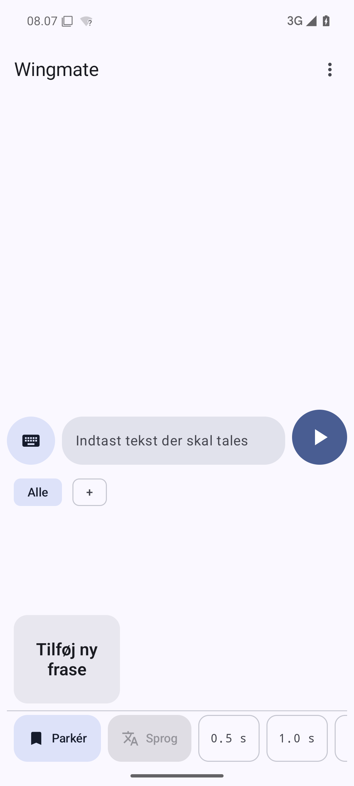
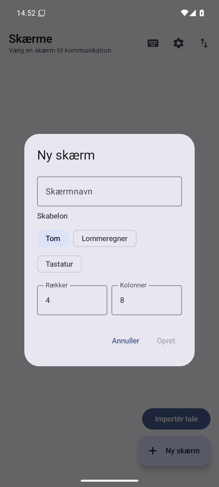
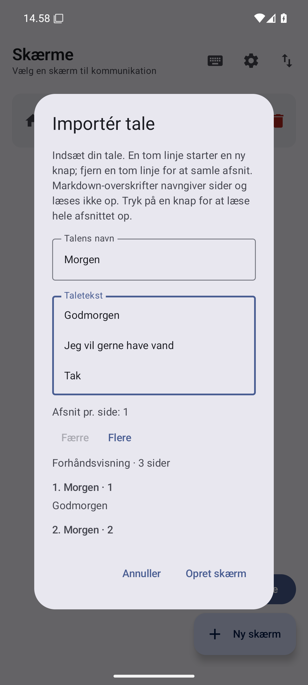
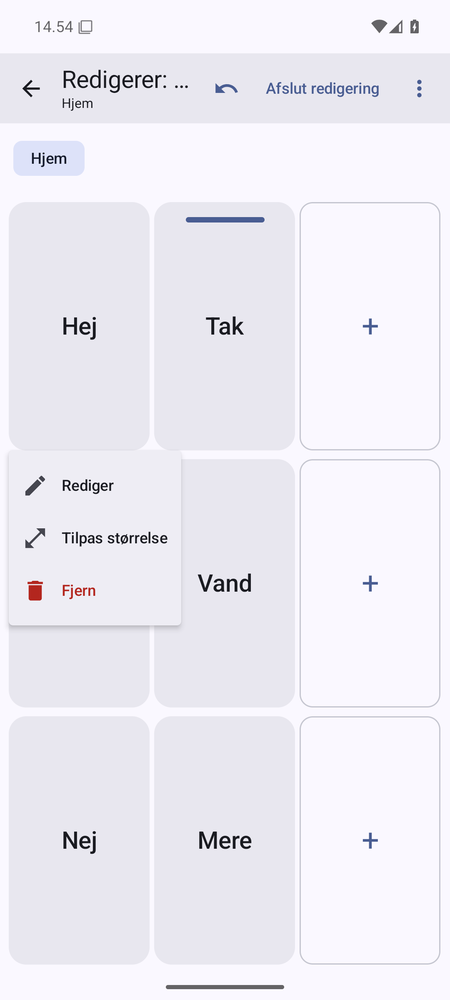
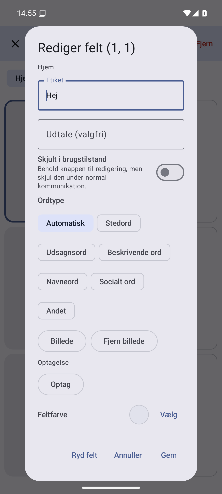
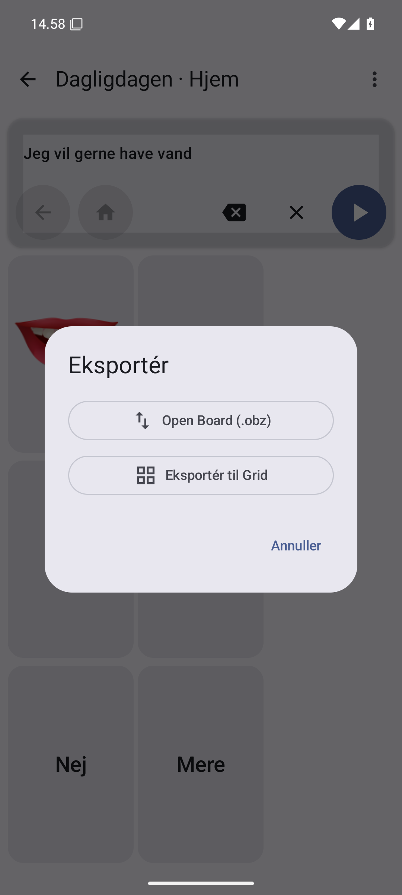
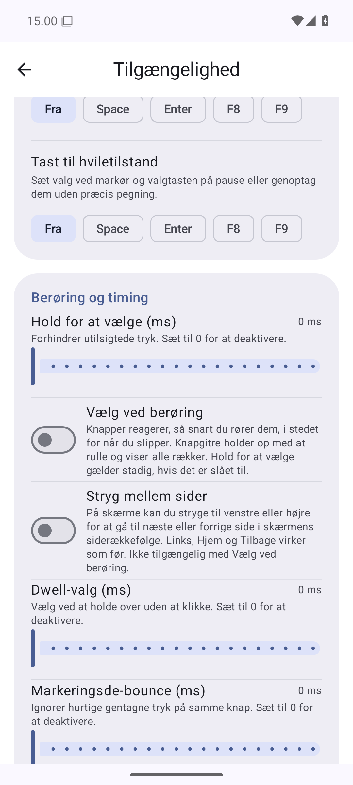

# Wingmate til Android – manual til nye brugere

Manualen passer til Wingmate **1.9.0** på Android (november 2026). Bruger du iPhone eller iPad, så læs [manualen til iPhone og iPad](MANUAL-ios.md).

## Sådan bruger du manualen

Manualen er til dig, der bruger Wingmate, og til familie, hjælpere, lærere og terapeuter, der hjælper med at sætte den op.

- Er du helt ny? Start med [Første start](#første-start) og [De to arbejdsområder](#de-to-arbejdsområder).
- Knap- og menunavne står med **fed**, præcis som de står i appen. Appen er på dansk, når telefonen eller tabletten er sat til dansk.
- Billederne er taget på en Android-telefon med dansk sprog.

> [!IMPORTANT]
> Wingmate må ikke være din eneste måde at tilkalde hjælp på i en nødsituation.

## Indhold

- [Hvad er Wingmate](#hvad-er-wingmate)
- [Installation](#installation)
- [Første start](#første-start)
- [De to arbejdsområder](#de-to-arbejdsområder)
- [Skrivning](#skrivning)
- [Skærme](#skærme)
  - [Opret eller importér en skærm](#opret-eller-importér-en-skærm)
  - [Kommunikér med en skærm](#kommunikér-med-en-skærm)
  - [Rediger sider og knapper](#rediger-sider-og-knapper)
  - [Symboler, billeder, farver og størrelse](#symboler-billeder-farver-og-størrelse)
  - [Sider og navigation](#sider-og-navigation)
  - [Skærm- og sideindstillinger](#skærm--og-sideindstillinger)
- [Låsning af redigering](#låsning-af-redigering)
- [Stemmer](#stemmer)
- [Import og eksport](#import-og-eksport)
- [Sikkerhedskopi](#sikkerhedskopi)
- [Indstillinger](#indstillinger)
- [Tilgængelighed og betjening](#tilgængelighed-og-betjening)
- [Fejlfinding](#fejlfinding)
- [Giv feedback](#giv-feedback)
- [Om denne manual](#om-denne-manual)

## Hvad er Wingmate

Wingmate er en gratis app, der kan tale for dig. Den hjælper med alternativ og supplerende kommunikation (ASK). Det vil sige, at appen siger det, du ikke kan sige med din egen stemme.

Jonas Dreiøe har lavet Wingmate. Han har selv cerebral parese og bruger den slags hjælpemidler hver dag.

Du kan tale på to måder. Begge er rigtige måder at bruge appen på:

- **Skrivning** – skriv en besked, eller tryk på gemte fraser. Så læser Wingmate op.
- **Skærme** – tryk på symboler og knapper. Knapperne ligger på sider, der hænger sammen.

Beskeden, du er i gang med, bliver liggende. Den følger med, når du skifter mellem skrivning og skærme, lukker appen eller genstarter enheden. Den forsvinder først, når du selv rydder den.

### Wingmate følger med dig gennem livet

Du behøver ikke skifte app, når dine behov ændrer sig – Wingmate kan vokse med dig fra de første symboler til skole, tastatur og oplæg:

- **Tidlig kommunikation** – byg **Skærme** med symboler, og brug tid på at lære at kommunikere med ASK. Forældre og pædagoger vil også kunne fjernredigere skærme (kommer snart).
- **Skolen** – lærere kan lave skærme til deres elever og dele dem med alle, der bruger Wingmate, via Google Drive, OneDrive eller iCloud (kommer snart). Brugere kan også dele skærme med hinanden som filer (se [Import og eksport](#import-og-eksport)).
- **Skrivning med tastatur** – når du vil, kan du nemt skifte til **Skrivning** og stave med et tastatur. Dine skærme er stadig bare et par tryk væk (se [De to arbejdsområder](#de-to-arbejdsområder)).
- **Oplæg og taler** – når du skal holde et oplæg eller en tale, kan du skrive teksten i fx Word og kopiere den direkte ind i **Importér tale** (se [Opret eller importér en skærm](#opret-eller-importér-en-skærm)).

### Dine data

Wingmate gemmer dine beskeder, fraser og skærme på enheden. Der er ingen konto, og appen kopierer ikke selv dine ting til en anden enhed.

Wingmate sender kun noget ud af enheden i disse tilfælde. Bruger du enhedens egen stemme, kan nogle af stemmerne alligevel bruge internettet.

- Vælger du en stemme på nettet, sendes teksten til den tjeneste, der læser den op.
- Søger du efter symboler på nettet, sendes det, du søger på.
- Slår du anonym rapportering til, sendes oplysninger om, hvilke funktioner du bruger. De indeholder aldrig dine beskeder.

## Installation

Hent Wingmate i [Google Play](https://play.google.com/store/apps/details?id=com.hojmoseit.wingmate). Du skal have Android 7.0 eller nyere. Appen er gratis. Der er ikke noget, du kan købe inde i appen.

## Første start

Første gang du åbner Wingmate, viser den en kort opsætning. Du kan ændre alle valg senere under **Indstillinger**. Se [Indstillinger](#indstillinger), hvis du vil vide, hvordan du åbner dem.

Har du allerede Wingmate på en anden enhed, kan du hente dine ting ind allerede på den første side. Tryk **Gendan en sikkerhedskopi**. Se [Sikkerhedskopi](#sikkerhedskopi).

1. Tryk **Opsæt Wingmate**.
2. Vælg, hvad der skal tale for dig. Vælg **Denne enhed**, hvis du vil bruge telefonens egen stemme. Vælger du en stemme på nettet, kan Wingmate bede om en nøgle, før du kommer videre. Se [Stemmer](#stemmer). Tryk **Fortsæt**.

   <!-- SCREENSHOT: Android welcome step “Hvad skal tale for dig?” with the four engine options visible: Denne enhed, Microsoft Azure, Google Cloud, ElevenLabs. -->
   

3. På siden **Vælg en stemme** trykker du på en stemme. Så går appen selv videre. Står der allerede «Valgt: …», kan du bare trykke **Fortsæt**.
4. På siden **Hør din stemme** trykker du **Afspil** for at høre stemmen. Vil du ændre, hvor hurtigt den taler, så brug **Hastighed**.
5. Vil du skifte sprog, så tryk **Skift sprog**, hvis knappen vises. Vælg et sprog, og tryk **Fortsæt**. Så kommer du tilbage til **Hør din stemme**.
6. Tryk **Fortsæt** på **Hør din stemme** for at gå videre.
7. Vælg, hvordan du vil tale: **Skrivning** («Skriv beskeder, og tryk på gemte fraser») eller **Skærme** («Tryk på symboler på sider. Opret eller importér en skærm for at starte»). Tryk **Fortsæt**.

   <!-- SCREENSHOT: Android welcome step “Hvordan vil du kommunikere?” showing the two cards Skrivning and Skærme. -->
   

8. Vælg, om du vil slå **Vis talehistorik** og **Del anonym analysedata** til. Analysedata er slukket fra start. De indeholder ikke dine ord eller nøgler. Tryk **Fortsæt**.
9. På siden **Klar til at kommunikere** kan du se dine valg. Tryk **Begynd at kommunikere**.

## De to arbejdsområder

Når opsætningen er færdig, åbner Wingmate det sted, du valgte. Du kan skifte, når du vil:

- Fra Skrivning: tryk på de tre prikker øverst til højre, og vælg **Skift til skærme**. Er tastaturet fremme, så tryk først på plusset til venstre for tekstfeltet, så de tre prikker kommer frem. På en bred skærm, fx en tablet, trykker du på gitter-ikonet i panelet til højre.

  <!-- SCREENSHOT: Typing workspace in communication use: message bar with some text, phrase grid or Typing Screen visible, and the control to switch to Screens visible in the toolbar or menu. -->
  

- Fra oversigten **Skærme**: tryk på tastatur-ikonet øverst (**Skift til tastatur og fraser**).

  <!-- SCREENSHOT: Screens library (Skærme) with the title “Skærme”, at least one screen card, and actions such as Ny skærm / Opret skærm and Importer skærm / Importér tale visible. -->
  

- Fra en åben skærm på en telefon: tryk på de tre prikker øverst til højre, og vælg **Skift til tastatur og fraser**. På en bred skærm er der et tastatur-ikon øverst. Vil du tilbage til oversigten **Skærme**, så tryk på pilen øverst til venstre.

Du kan også vælge, hvor appen skal starte. Gå til **Indstillinger → System og data**, og vælg under **Åbn ved opstart**: **Tastatur** eller **Skærme**. Vælger du Skærme, kan du også vælge en bestemt skærm eller **Skærmoversigt**.

## Skrivning

I Skrivning kan du skrive en ny besked eller trykke på en frase. En frase er et ord eller en besked, du har gemt, fx «Tak».

### Skriv og læs op

- Skriv i feltet **Indtast tekst der skal tales**.
- Tryk på den runde afspil-knap (▶) – på en bred skærm knappen **Afspil** i panelet til højre – så bliver beskeden læst op. Mens den læser, kan du trykke **Pause**, **Fortsæt** og **Stop**.
- På en telefon: tryk på tastatur-knappen til venstre for tekstfeltet for at få tastaturet frem. Mens tastaturet er fremme, er knappen et plus. Tryk på plusset for at komme tilbage til fraserne og de tre prikker øverst. TalkBack kalder knappen **Vis tastatur** eller **Vis skriveskærm**.
- På en bred skærm, fx en tablet: tryk **Vis tastatur** i panelet til højre. Tryk **Skjul tastatur** samme sted for at skjule tastaturet igen.
- Skriveskærmen viser dine fraser som knapper.

### Siderne på skriveskærmen

- Du starter som regel på siden **Alle**. Den viser alle dine fraser.
- Hver kategori får sin egen side.
- Er talehistorik tændt, kan siden **Historik** vises.
- **Sandsynligt næste** er en side, der foreslår hele beskeder ud fra det, der er sagt på denne enhed. Den er stadig ny. Du tænder den med **Sandsynlige næste beskeder (eksperimentel)** under **Indstillinger → Privatliv**. Valget vises kun, når **Vis talehistorik** er slået til.

Skriveskærmen bygger selv sine sider ud fra dine fraser og kategorier. Du kan ikke flytte rundt på siderne eller slette skriveskærmen. Vil du selv bygge sider, bruger du **Skærme**.

### Gem en frase

Tryk på knappen **Tilføj ny frase**. Den står efter din sidste frase, nogle gange på en ny række længere nede, selv om der er tomme felter. Rul ned i fraserne, hvis du ikke kan se den. Her kan du sætte:

- **Vokalisering (det der skal siges)** – det øverste felt. Brug det, hvis Wingmate skal sige noget andet end teksten på knappen. Lader du feltet stå tomt, læser Wingmate teksten fra **Ny frasetekst** op.
- **Ny frasetekst** – teksten, der står på knappen. Lader du feltet stå tomt, bruges teksten fra **Vokalisering**.
- **Billede** – tryk, og vælg **Foto** eller **Symbol**.
- **Optagelse** – tryk **Optag** for at indtale frasen selv.
- **Farve** – vælg en farve, eller tryk **Brug farve**.
- **Tilhører kategori** – vælg, hvilken kategori frasen skal ligge i.

Du kan også markere frasen som **Skjult**, så den ikke vises blandt knapperne. Tryk **Gem**, når du er færdig.

<!-- SCREENSHOT: Phrase editor dialog open (Tilføj ny frase or Rediger frase) showing fields for text, vocalization, image (Foto / Symbol), color, and category. -->

### Ordn dine fraser

- Hold fingeren på en frase, og vælg **Rediger** for at rette den. Træk frasen for at flytte den.
- Tryk på **+** sidst i rækken med kategorier (efter **Alle** og dine egne kategorier) for at lave en kategori (**Tilføj kategori**). En kategori kan ikke ligge inde i en anden kategori.

> [!TIP]
> Er **Hold for at vælge (ms)** over `0`, eller er **Vælg ved berøring** slået til, kan du ikke holde fingeren på en frase for at rette eller flytte den. Sæt **Hold for at vælge (ms)** til `0`, og slå **Vælg ved berøring** fra under **Indstillinger → Tilgængelighed**, mens du retter. Slå dem til igen bagefter.

### Læg en besked til side

Du kan lægge den besked, du er i gang med, til side og starte på en ny. Tryk **Hold** ved bogmærket, nederst på skriveskærmen på en telefon og i panelet til højre på en tablet. Knappen står på engelsk i denne version. Den gemte tekst vises som **Parkeret:**. Tryk **Byt** for at bytte om på den nye besked og den, der ligger til side.

## Skærme

En **skærm** er et sæt sider med et navn. Der er knapper på siderne, og én side er startsiden. Oversigten hedder **Skærme** («Vælg en skærm til kommunikation»).

### Opret eller importér en skærm

Sådan laver du en ny skærm:

1. Tryk **Ny skærm** i oversigten **Skærme**.
2. Skriv et **Skærmnavn**.
3. Vælg en skabelon: **Tom**, **Lommeregner** eller **Tastatur** (layout **QWERTY** eller **Alfabetisk**).
4. Til en tom skærm vælger du, hvor mange **Rækker** og **Kolonner** der skal være.
5. Tryk **Opret**.

<!-- SCREENSHOT: New screen dialog on Android, showing template choices Tom, Lommeregner and Tastatur, plus name and grid size fields for a blank screen. -->

Har du en tavlefil fra en anden ASK-app, kan du hente den ind. Tryk på pilene ↑↓ øverst til højre i oversigten (**Importer skærm**), og vælg filen. Filen ender på `.obf` (én side) eller `.obz` (flere sider og billeder). Filer med adgangskode kan ikke hentes ind. Gem dem først uden adgangskode.

Skal du holde et oplæg eller en tale, kan du skrive teksten i fx Word og lave en skærm ud fra den:

1. Tryk **Importér tale**.
2. Skriv et navn under **Talens navn**.
3. Sæt teksten ind under **Taletekst**. Lav en tom linje mellem de afsnit, der skal have hver sin knap.
4. Vil du give en side et navn, så skriv fx `# Velkomst` på sin egen linje. Linjen bliver ikke læst op.
5. Vælg med **Færre** og **Flere** under **Afsnit pr. side**, hvor mange afsnit der skal være på hver side (1–8). Se resultatet under **Forhåndsvisning**.
6. Tryk **Opret skærm**. Du kan rette skærmen bagefter.

Når du senere trykker på en knap fra **Importér tale**, læser Wingmate hele afsnittet op med det samme. Teksten lægges ikke i beskedlinjen.

<!-- SCREENSHOT: Importér tale sheet with sample pasted text, paragraph-per-page control, and a preview of generated pages. -->

Tryk på en skærms navn i oversigten for at åbne den. Ikonerne til højre på kortet er: blyant (**Rediger**), to ark (**Dupliker**), hængelås (**Lås** / **Lås op**) og skraldespand (**Slet**).

> [!WARNING]
> En slettet skærm kan ikke hentes tilbage.

### Kommunikér med en skærm

Åbn en skærm, og tryk på knapperne. En knap kan læse op, lægge tekst i beskedlinjen eller åbne en anden side. Det afhænger af, hvordan knappen er sat op.

Er **Beskedlinje** vist, har den knapper med ikoner. På en bred skærm står navnet ved siden af ikonet:

- ▶ (**Afspil**) læser beskeden op.
- ⌫ (**Slet ord**) fjerner den sidste del af beskeden, fx hele teksten fra den sidste knap, du trykkede på. På en staveside fjerner den det sidste tegn.
- ✕ (**Ryd**) sletter hele beskeden.

Har skærmen flere sider, er der også to knapper til venstre i beskedlinjen:

- ← går en side tilbage (**Forrige side**).
- ⌂ går til startsiden (**Startside**).

Bruger du TalkBack, hører du **Læs sætningen op**, **Slet sidste ord** og **Ryd sætningen**.

Er **Stryg mellem sider** tændt under **Tilgængelighed**, kan du også stryge: mod venstre for at gå til næste side, og mod højre for at gå til forrige side. Fra den sidste side kommer du ikke til den første ved at stryge, og omvendt. Strygning virker ikke, mens **Vælg ved berøring** er tændt.

Vil du se de skjulte knapper et øjeblik, så tryk på de tre prikker øverst til højre, og vælg **Vis skjulte knapper midlertidigt**. Ser du et øje øverst i stedet, så tryk på øjet.

<!-- SCREENSHOT: An open Screen in communication (not editing) mode: a grid of symbol buttons, message bar with a short composed message, and page navigation (Forrige side / Startside) visible. -->

### Rediger sider og knapper

> [!TIP]
> Er du bange for at ødelægge noget? Tryk **Dupliker** i oversigten først. Så har du en kopi af skærmen, som den var.

Er skærmen låst, så tryk først på den åbne hængelås til højre på kortet (**Lås op**) i oversigten **Skærme**. Er der sat en redigeringskode, så tast den. Se [Låsning af redigering](#låsning-af-redigering).

Sådan åbner du en skærm til redigering:

- I oversigten **Skærme**: tryk på blyanten (**Rediger**).
- På en åben skærm: tryk på de tre prikker øverst til højre, og vælg **Rediger skærm**. Ser du en blyant øverst i stedet, så tryk på blyanten.

Mens du redigerer:

- Tryk på et tomt felt for at lave en ny knap. Skriv fx `Ja` under **Etiket**, og tryk **Gem**.
- Tryk på en knap for at vælge den, og tryk **Rediger** eller **Fjern** øverst. Du kan også holde fingeren på knappen og vælge **Rediger**, **Tilpas størrelse** eller **Fjern**, eller trække knappen til et andet felt.
- Tryk på de tre prikker øverst til højre for at se flere valg: **Tilføj side**, **Brug som startside**, **Tilpas sidens størrelse**, **Slet side**, **Skærmindstillinger** og **Sideindstillinger**. På en bred skærm, fx en tablet, står de fleste som ikoner øverst, og under de tre prikker finder du kun **Tilføj side**.
- **Tilpas sidens størrelse** ændrer antal rækker og kolonner. Skal siden gøres mindre, skal de knapper, der ikke kan være der, først flyttes.
- Den buede pil øverst (**Fortryd**) tager det sidste trin tilbage.
- Skjulte knapper vises, mens du redigerer.

Når du er færdig, trykker du **Afslut redigering**. Vælg **Gem ændringer**, **Kassér** eller **Fortsæt redigering**.

<!-- SCREENSHOT: A Screen in edit mode (banner or title “Redigerer: …”). One button is selected or a context menu shows Rediger, Tilpas størrelse and Fjern. Empty cells and the finish-editing action are visible. -->

### Symboler, billeder, farver og størrelse

Når du redigerer en knap (vinduet hedder **Rediger felt**), kan du blandt andet sætte:

- **Etiket** – teksten, der står på knappen.
- **Udtale (valgfri)** – det, der skal siges, hvis det skal være noget andet end etiketten.
- **Billede** – søg efter et symbol, eller vælg et foto fra enheden. Søgeskærmen hedder **Søg efter symboler**, og du skriver i feltet **Søg efter piktogram...**. Symbolerne kommer fra OpenSymbols. Det er en samling af billeder, blandt andet fra ARASAAC og Mulberry.
- **Feltfarve**, **Knapform** (**Rundet**, **Firkantet**, **Pille**, **Taleboble**, **Tankeboble**) og **Ordtype**. Ordtype kan være **Automatisk**, eller du vælger selv: **Stedord**, **Udsagnsord**, **Beskrivende ord**, **Navneord**, **Socialt ord** eller **Andet**.
- **Skjult i brugstilstand** – knappen er der stadig, når du redigerer, men den vises ikke, når du bruger skærmen.
- **Sprog** for den enkelte knap, hvis den skal siges på et andet sprog end det normale.

Du kan hente hele ARASAAC-biblioteket ned under **Indstillinger → System og data → Offline-symboler**. Tryk **Download symboler**. Så virker symbolsøgningen også uden net. Det fylder omkring 300 MB. Brug gerne wi-fi.

**Ordtypefarver** er Fitzgerald-farver. Hver ordtype får sin egen farve, så det er lettere at se, hvad ordet er. De er slukket fra start. Tænd dem under **Indstillinger → Skærm og layout**. Sætter du selv en farve på knappen, er det den farve, der bruges.

<!-- SCREENSHOT: Edit-cell dialog (Rediger felt) with label, vocalization, an image or symbol on the button, color control, and shape or word-type options visible. -->

<!-- SCREENSHOT: Symbol search screen “Søg efter symboler” with a search query entered and a grid of matching pictograms from OpenSymbols. -->

### Sider og navigation

I **Rediger felt** bestemmer du, hvad en knap gør, under **Felthandling**. Vælg **Tilføj og udtal** eller **Åbn side**.

Sådan får du en knap til at åbne en anden side:

1. Mangler siden, så vælg **Tilføj side**, giv siden et navn, og tryk **Opret**. Wingmate viser nu den nye side.
2. Tryk på navnet på den side, hvor knappen skal ligge, i rækken med sider øverst.
3. Tryk på knappen, og vælg **Rediger**. Vælg **Åbn side** under **Felthandling**.
4. Tryk **Vælg en side** under **Målside**, vælg siden, og tryk **Gem**.

**Særlige handlinger** kan lægges på en knap. De hedder blandt andet:

- **Stav et ord**
- **Tilføj mellemrum**
- **Slet sidste tegn**
- **Ryd sætning**
- **Gå til startside**
- **Udtal sætning**
- **Forudsig næste ord**

Har du tændt flere handlinger, kan du ændre rækkefølgen med **Flyt handling op** og **Flyt handling ned**.

Du kan også bestemme, hvad der sker, når du har trykket på en almindelig knap. Under **Efter valg** vælger du **Bliv på denne side**, **Gå tilbage til forrige side** eller **Gå til startsiden**. Du kan sætte det for hele appen under **Indstillinger → Skærm og layout** og vælge noget andet for en enkelt skærm eller side.

### Skærm- og sideindstillinger

Åbn skærmen til redigering (se [Rediger sider og knapper](#rediger-sider-og-knapper)). Tryk på de tre prikker øverst til højre, og vælg **Skærmindstillinger** eller **Sideindstillinger**. På en bred skærm står de som ikoner øverst: tandhjulet åbner **Skærmindstillinger**, og blyanten åbner **Sideindstillinger**. Her kan du blandt andet:

- give skærmen eller siden et nyt navn
- slå **Vis etiketter** og **Vis symboler** til eller fra, og vælge **Etikettens placering** (**Øverst** eller **Nederst**), når begge vises
- tænde eller slukke **Beskedlinje**, **Oplæsningsknap i beskedlinjen** og **Redigerbar beskedlinje**
- vælge **Aktivering af knap**: **Læs op og tilføj**, **Tilføj uden oplæsning** eller **Læs op uden at tilføje**
- vælge **Efter valg** (bliv, forrige side eller startside)
- vælge **Sidebaggrund** og et **Baggrundsbillede** under **Sideindstillinger**. Billedet kan fylde hele siden (**Fyld siden**) eller vises helt (**Hele billedet**).
- tænde **Forudindlæs tale**. Så laver Wingmate lyden til alle knapper på forhånd med den stemme, du har valgt på nettet. Det koster hos den, der leverer stemmen, og det fylder på enheden. Det er slukket fra start.

En skærm kan følge appen med **Brug appstandard**, og en side kan følge skærmen med **Brug skærmindstilling**. **Nulstil skærmindstillinger** og **Nulstil sidetilpasninger** fjerner dine egne valg.

<!-- SCREENSHOT: Screen settings page (Skærmindstillinger) showing appearance and communication options such as Vis etiketter, Vis symboler, Beskedlinje and Aktivering af knap. -->

## Låsning af redigering

Der er to låse. Begge stopper kun redigering. Du kan altid tale.

### Redigeringskode for hele appen

**Redigeringsadgang** er en valgfri kode til hele appen. Du finder den under **Indstillinger → System og data**.

1. Tryk **Kræv en redigeringskode**.
2. Skriv en kode på 4 til 8 cifre under **Redigeringskode**. Der står: «Indtast 4 til 8 cifre. Koden blokerer aldrig kommunikation.»
3. Skriv den samme kode igen under **Bekræft kode**, og tryk **OK**.

Bagefter kan du trykke **Skift redigeringskode**, **Deaktivér redigeringskode** eller **Lås redigering nu**.

- Taster du forkert flere gange, venter appen, før du kan prøve igen («For mange forsøg. Vent et øjeblik, og prøv igen»).
- Wingmate bruger kun denne kode med tal. Den bruger ikke fingeraftryk, ansigtsgenkendelse eller enhedens egen kode.
- Koden kommer ikke med i en sikkerhedskopi. Efter en gendannelse skal du sætte koden igen, hvis du vil bruge den.

> [!WARNING]
> Wingmate kan ikke nulstille en glemt redigeringskode. Skriv koden ned, og gem den et sikkert sted.

<!-- SCREENSHOT: Settings section Redigeringsadgang, with the description “Kræv eventuelt en kode til redigering. Kommunikation er altid tilgængelig.” and the action Kræv en redigeringskode (or the enabled state with Skift / Deaktivér). -->

### Lås på en enkelt skærm

**Lås** fryser sider og knapper på en skærm. De kan ikke ændres, før du trykker **Lås op**. Er redigeringskoden tændt, skal den tastes for at låse eller låse op. En låst skærm har en lukket hængelås foran navnet i oversigten. TalkBack læser den som **Låst**. Du kan stadig åbne den og tale.

<!-- SCREENSHOT: Screens library showing a screen marked Låst, with the unlock action (Lås op) visible and the Edit action disabled or unavailable. -->

## Stemmer

Du vælger, hvad der skal tale, i opsætningen eller under **Indstillinger → Tale og sprog**. Stemmerne hedder ikke helt det samme de to steder:

| I opsætningen | I indstillingerne | Hvad du får | Skal du være på nettet? |
| --- | --- | --- | --- |
| **Denne enhed** | **System** eller **System-TTS** | Enhedens egne stemmer. | Kan virke uden net. Nogle stemmer på enheden bruger alligevel internet. |
| **Microsoft Azure** | **Azure** eller **Azure TTS** | Naturlige stemmer fra Microsoft. Du bruger din egen nøgle. | Kræver internet. Dine ord sendes til Microsoft. Det kan koste penge. |
| **Google Cloud** | **Google** eller **Google Cloud TTS** | Stemmer fra Google. Du bruger din egen nøgle. | Kræver internet. Dine ord sendes til Google. Det kan koste penge. |
| **ElevenLabs** | **ElevenLabs** | Stemmer fra din ElevenLabs-konto, også en kopi af en stemme, du selv har lavet der. | Kræver internet. Dine ord sendes til ElevenLabs. Det tæller med i din konto. |

En stemme på enheden kræver ingen nøgle. Stemmerne på nettet kræver en nøgle, du selv laver hos Microsoft, Google eller ElevenLabs. Wingmate gemmer nøglen sikkert på enheden. Den kommer ikke med i en sikkerhedskopi.

Sådan sætter du en stemme på nettet op:

1. Gå til **Indstillinger → Tale og sprog**. Tryk **Azure**, **Google** eller **ElevenLabs** under **Talemotor**.
2. Tryk **Opsæt Azure**, **Opsæt Google Cloud TTS** eller **Opsæt ElevenLabs**, og følg trinene på skærmen. Har du allerede en Google-nøgle, hedder knappen **Erstat API-nøgle**.
3. Sæt nøglen ind. Til Azure skal du også udfylde **Placering/Region**.
4. Tryk **Gem**. Ved Google trykker du derefter **Fortsæt**, når appen har godkendt nøglen.

Virker nøglen ikke, beholder Wingmate den gamle opsætning.

Derefter vælger du en stemme i **Vælg stemme**. Under **Sprog** vælger du et **Hovedsprog** og eventuelt et **Andet sprog**. Bruger du en stemme på nettet, kan du trykke **Indstillinger** ud for stemmen i **Vælg stemme** og ændre hastighed og tonehøjde, hvis stemmen kan det.

ElevenLabs kan ikke ændre tonehøjde her, og hastigheden kan blive ignoreret. Vil du have ElevenLabs til at tale langsommere, så skriv et engelsk ord i firkantede klammer foran teksten, for eksempel `[slowly]`.

Er stemmen på nettet ikke til at få fat i, læser enhedens stemme op i stedet. Wingmate siger, at stemmen på nettet ikke var tilgængelig. Beskeden bliver ikke slettet.

Under **Udtaleordbog** kan du lære Wingmate, hvordan navne og ord skal siges. Ordbogen virker ikke med ElevenLabs.

Vil du vide mere om nøgler og stemmer, så se [elevenlabs-tts.md](elevenlabs-tts.md) og [google-cloud-tts.md](google-cloud-tts.md) (på engelsk).

<!-- SCREENSHOT: Settings → Tale og sprog, with the speech engine options (System, Azure, Google, ElevenLabs) and a selected voice visible. -->

<!-- SCREENSHOT: Voice picker (Vælg stemme) filtered to a language, with at least one voice selected and the preview/play control visible. -->

## Import og eksport

Vil du flytte en skærm til en anden enhed eller en anden ASK-app, sender du den som en fil. Wingmate har ingen konto, der gemmer dine skærme.

### Hent en skærm ind

Fra oversigten **Skærme**:

- En tavlefil: tryk på pilene ↑↓ øverst til højre (**Importer skærm**). `.obf` er én side. `.obz` er flere sider og billeder.
- En tekst: tryk **Importér tale**, som beskrevet [ovenfor](#opret-eller-importér-en-skærm).

### Send en skærm ud

1. Åbn skærmen.
2. Tryk på de tre prikker øverst til højre, og vælg **Importer/eksporter data**. På en bred skærm, fx en tablet, trykker du i stedet på pilene ↑↓ øverst. Så åbner **Eksportér**.
3. Vælg, hvad du vil lave:
   - **Open Board (.obz)** – skærmen i en fil, som andre ASK-apps også kan læse.
   - **Eksportér til Grid** – en fil til Smartbox Grid 3. I Grid Explorer vælger du **Add Grid Set → Grid set file**. Se [Smartbox’ vejledning til Grid Explorer](https://hub.smartboxaac.com/knowledgebase/grid-explorer-in-grid-3/) (på engelsk).

   <!-- SCREENSHOT: The Eksportér dialog, showing Open Board (.obz) and Eksportér til Grid. -->
   

Vil du udskrive skærmen, laver du en PDF. Tryk på de tre prikker øverst til højre, og vælg **Udskriv (PDF)**. På en tablet, hvor der ikke er tre prikker øverst, kan du ikke udskrive i denne version. Du får som regel ét liggende A4-ark pr. side. En knap, der går til en anden side, får skrevet, hvilken side den går til.

### Hvad følger med til Grid

Siderne følger med, og det samme gør knappernes plads og størrelse, tekster, det der skal siges, farver og de billeder og lyde, Grid kan afspille. Er beskedlinjen tændt, lægger Wingmate en talerække øverst i Grid. Optagelser, som Grid kan afspille, afspilles, når knappen vælges. En samlet besked sendes som tekst.

Det her følger ikke med til Grid: ordforslag i Wingmate, ekstra elementer på siden, baggrundsbilleder og et særligt stemmevalg på den enkelte knap. Wingmate kan sende en skærm til Grid. Den kan ikke hente en Grid-fil ind igen.

Skriveskærmen kan ikke sendes ud. Det er kun dine egne skærme.

## Sikkerhedskopi

En sikkerhedskopi gemmer dine skærme, fraser, indstillinger og meget mere fra *denne* enhed i én fil. Brug den til at flytte til en ny enhed eller til at passe på dine ting. Vil du dele en enkelt skærm med andre, så brug [Import og eksport](#import-og-eksport) i stedet.

Du finder **Sikkerhedskopiér Wingmate** under **Indstillinger → System og data**.

- **Opret sikkerhedskopi** gemmer eller deler en fil. Den ender på `.wingmate-backup`.
- **Gendan sikkerhedskopi**: vælg filen, og tryk **Validér og erstat**. Wingmate tjekker filen og erstatter så de data, der ligger på enheden nu. Tryk **Annuller**, hvis du vil beholde dine nuværende data.

Kopien kan indeholde skærme, sider, fraser, kategorier, billeder, optagelser, indstillinger, talehistorik, stemmevalg og udtaleordbog. Dit valg af stemme kommer med. Bruger du Azure, kommer regionen også med, men ikke selve nøglen. Redigeringskoden og midlertidige lydfiler kommer heller ikke med. Efter en gendannelse skal du sætte nøglen og en eventuel redigeringskode op igen.

> [!WARNING]
> Filen er ikke låst med en kode, og den kan indeholde dine beskeder. Gem den et sikkert sted.

Vil du se, hvordan filen er bygget op, så læs [BACKUP_FORMAT.md](BACKUP_FORMAT.md) (på engelsk).

<!-- SCREENSHOT: The Sikkerhedskopiér Wingmate settings group, showing the description and the buttons Opret sikkerhedskopi and Gendan sikkerhedskopi. -->

## Indstillinger

Sådan åbner du **Indstillinger**:

- Fra Skrivning på en telefon: tryk på de tre prikker øverst til højre, og vælg **App-indstillinger**. Er tastaturet fremme, så tryk først på plusset til venstre for tekstfeltet.
- Fra Skrivning på en bred skærm, fx en tablet: tryk på tandhjulet i panelet til højre.
- Fra **Skærme**: tryk på tandhjulet øverst.

Du kan søge med **Søg i Indstillinger**. **Udtaleordbog** er sit eget punkt på forsiden af **Indstillinger**.

| Afsnit | Her finder du blandt andet |
| --- | --- |
| **Tale og sprog** | Hvad der taler, stemme og sprog. Hastighed for stemmer på nettet |
| **Skærm og layout** | Etiketter og symboler, knappernes opstilling, kontrast, **Ordtypefarver**, skrift- og knapstørrelse, beskedlinje |
| **Tilgængelighed** | Berøring og tid, betjening, lyd og markering |
| **Privatliv** | **Vis talehistorik**, **Sandsynlige næste beskeder (eksperimentel)**, gemte sætninger, anonym rapportering |
| **System og data** | **Åbn ved opstart**, redigeringskode, sikkerhedskopi, hentning af ARASAAC-symboler, **Velkomstskærm** |

Andre valg, der er gode at kende:

- **Tale ved valg** (under **Tilgængelighed**): **Straks** eller **Kun sætning**. Ved **Kun sætning** er appen stille, indtil den samlede besked læses op.
- **Vis talehistorik**: kun tale, der afspilles, mens dette er tændt, vises i historikken. Tale, der afspilles, mens det er slukket, vises ikke, men lyden kan stadig være gemt på enheden, så den kan bruges igen.
- **Rapportering af funktionsbrug**: valgfri, og slukket fra start. Ingen frasetekst, nøgler eller filstier sendes. Se [PRIVACY_POLICY.md](../PRIVACY_POLICY.md) (på engelsk).
- **Standardiseret logning (OBL)** (under **Privatliv**): en liste over brugen, som en terapeut kan gennemgå. Listen bliver på enheden.
- **Velkomstskærm** under **System og data** kører den første opsætning igen.

<!-- SCREENSHOT: The Settings home/overview, showing the category list: Tale og sprog, Skærm og layout, Tilgængelighed, Privatliv, and System og data. -->

## Tilgængelighed og betjening

Under **Tilgængelighed** kan du ændre, hvordan der peges og vælges. **Valgtast** og **Tast til hviletilstand** ligger i gruppen **Interaktion**.

Tider står i millisekunder (ms). 1000 ms er 1 sekund.

- **Hold for at vælge (ms)** – knappen vælges først, når du har holdt fingeren nede så længe. `0` slår det fra.
- **Dwell-valg (ms)** – knappen vælges, når markøren bliver stående på den, uden at du klikker. `0` slår det fra.
- **Vælg ved berøring** – knappen vælges, så snart du rører den, ikke når du slipper. Knapfelterne ruller ikke længere, og **Stryg mellem sider** virker ikke. **Hold for at vælge (ms)** gælder stadig, hvis det er tændt.
- **Stryg mellem sider** – stryg mod venstre for at gå til næste side, og mod højre for at gå til forrige side.
- **Markeringsde-bounce (ms)** – ignorerer hurtige tryk på den samme knap lige efter hinanden.
- **Markeringsfremhævning (ms)** og **Markeringslyd** – en kort ramme og en lyd, når en knap er valgt.
- **Auditiv bekræftelse** – Wingmate hvisker knappens tekst, når du rører knappen eller holder markøren over den.
- **Valgtast** – vælg en tast: **Space**, **Enter**, **F8** eller **F9**. Når du trykker på den, vælges den knap, markøren eller tastaturet står på.
- **Tast til hviletilstand** – vælg en tast, der sætter **Dwell-valg** og **Valgtast** på pause. Når **Dwell-valg** eller **Valgtast** er tændt, er der også en pause-/afspil-knap nederst til venstre. TalkBack kalder den **Hviletilstand** eller **Genoptag input**. Almindelige tryk virker stadig, mens der hviles. Tryk på knappen eller på hviletasten for at starte igen. Bruger du **Valgtast**, kan du også holde den nede i 2 sekunder.
- **Fremhævelse af markør** – behold den almindelige markør, eller læg en tydelig ring eller et omrids ovenpå. Under **Markørtype** er valgene **System**, **Ring** og **Outline**.

Wingmate kan bruges med finger, mus, pegefelt, tastatur, kontakt og den markør, systemet stiller til rådighed. Det gælder også øjen- og hovedstyring, når systemet giver en markør. Se [HEAD_EYE_TRACKING.md](HEAD_EYE_TRACKING.md) (på engelsk).

<!-- SCREENSHOT: Settings → Tilgængelighed, showing Hold for at vælge, Dwell-valg, Vælg ved berøring and Stryg mellem sider. -->

## Fejlfinding

**Stemmen på nettet virker ikke.** Tjek, at du har internet, og at nøglen stadig virker. Wingmate bruger enhedens stemme i stedet og beholder beskeden. Er nøglen blevet ændret, så sæt den nye ind under **Indstillinger → Tale og sprog**. Er du i den første opsætning, kan du trykke **Indtast nøglen igen**.

**Stemmerne på enheden mangler eller lyder forkert.** Stemmerne styres i telefonens egen app **Indstillinger**, typisk under **Tilgængelighed → Tekst-til-tale-output**. Navnet og stedet kan være lidt anderledes på din telefon.

**En tavlefil kan ikke hentes ind.** Appen siger selv, hvad der er galt: filen kan ikke åbnes, er ikke en tavle Wingmate kan læse, er gået i stykker, er for stor, mangler billeder eller lyde, eller er låst med en adgangskode.

**Skærmen kan ikke redigeres.** Se, om skærmen er **Låst**, og om redigeringskoden er tændt. Lås op, og tast koden, hvis der bliver spurgt om den.

**Jeg har glemt redigeringskoden.** Koden ligger kun på enheden og kommer ikke med i en sikkerhedskopi. Wingmate kan ikke nulstille den for dig. Sidder du fast, så skriv til udvikleren. Se [Giv feedback](#giv-feedback).

**Historik eller «Sandsynligt næste» vises ikke.** Gå til **Indstillinger → Privatliv**. Tænd **Vis talehistorik**, og tænd derefter **Sandsynlige næste beskeder (eksperimentel)**. Læs så en besked op, så vises **Historik**. Læs endnu en anden besked op. Når Wingmate har noget at foreslå, vises **Sandsynligt næste** også. Når tastaturet er fremme, vises forslagene også i en række over tastaturet.

**Søgningen finder ingen symboler, eller den er langsom.** Søgningen kræver net, medmindre symbolerne allerede ligger på enheden. Har du søgt mange gange lige efter hinanden, beder appen dig vente og prøve igen. Hent ARASAAC ned under **Indstillinger → System og data → Offline-symboler**, så virker det uden net.

**Appen er på et andet sprog end forventet.** Appen bruger enhedens sprog, hvis det findes i Wingmate. Dansk findes.

## Giv feedback

Fejl, ønsker og spørgsmål kan sendes som en sag på GitHub: [github.com/Jdreioe/Wingmate/issues](https://github.com/Jdreioe/Wingmate/issues).

Du kan også skrive til supportadressen fra Google Play: [wingmate@dreioe.dk](mailto:wingmate@dreioe.dk).

Når du beskriver et problem, så skriv gerne hvilken telefon eller tablet og hvilken version af appen du bruger, og om det sker i **Skrivning** eller **Skærme**.

## Om denne manual

Wingmate er gratis, og koden er åben: [github.com/Jdreioe/Wingmate](https://github.com/Jdreioe/Wingmate). Licens: GPL 3.0.

Manualen beskriver Wingmate, som den så ud i commit [`ab4a8e2`](https://github.com/Jdreioe/Wingmate/commit/ab4a8e242126a2dc2a978e52f5e077038a6770e2) på `main` (25. november 2026). Udgivelsen er `v1.9.0` på Google Play.

Der er ikke en udgave til computer i denne version. Den ældre computerudgave ligger under [`desktop-archive`](https://github.com/Jdreioe/Wingmate/tree/desktop-archive).
