# Wingmate til iPhone og iPad – manual til nye brugere

Manualen passer til Wingmate **1.9.1** på iPhone og iPad (november 2026). Bruger du Android, så læs [manualen til Android](MANUAL-android.md).

## Sådan bruger du manualen

Manualen er til dig, der bruger Wingmate, og til familie, hjælpere og terapeuter, der hjælper med at sætte den op.

- Er du helt ny? Start med [Første start](#første-start) og [De to arbejdsområder](#de-to-arbejdsområder).
- Knap- og menunavne står med **fed**, præcis som de står i appen. Appen er på dansk, når iPhone eller iPad er sat til dansk.
- Billederne er taget på iPhone og iPad med dansk sprog. De høje billeder er fra iPhone, og de brede billeder er fra iPad.

> [!IMPORTANT]
> Wingmate må ikke være din eneste måde at tilkalde hjælp på i en nødsituation.

## Indhold

- [Hvad er Wingmate](#hvad-er-wingmate)
- [Installation](#installation)
- [Første start](#første-start)
- [De to arbejdsområder](#de-to-arbejdsområder)
- [Skrivning](#skrivning)
- [Skærme](#skærme)
  - [Opret en skærm](#opret-en-skærm)
  - [Kommunikér med en skærm](#kommunikér-med-en-skærm)
  - [Rediger sider og knapper](#rediger-sider-og-knapper)
  - [Symboler, billeder, farver og størrelse](#symboler-billeder-farver-og-størrelse)
  - [Sider og navigation](#sider-og-navigation)
  - [Skærm- og sideindstillinger](#skærm--og-sideindstillinger)
- [Låsning af redigering](#låsning-af-redigering)
- [Stemmer](#stemmer)
- [Eksport og udskrift](#eksport-og-udskrift)
- [Sikkerhedskopi](#sikkerhedskopi)
- [Indstillinger](#indstillinger)
- [Tilgængelighed og betjening](#tilgængelighed-og-betjening)
  - [Scanning](#scanning)
  - [Styring med øjne, hoved og kontakt](#styring-med-øjne-hoved-og-kontakt)
- [Fejlfinding](#fejlfinding)
- [Giv feedback](#giv-feedback)
- [Om denne manual](#om-denne-manual)

## Hvad er Wingmate

Wingmate er en gratis app, der kan tale for dig. Den hjælper med alternativ og supplerende kommunikation (ASK). Det vil sige, at appen siger det, du ikke kan sige med din egen stemme.

Jonas Dreiøe har lavet Wingmate. Han har selv cerebral parese og bruger den slags hjælpemidler hver dag.

Du kan tale på to måder. Begge er rigtige måder at bruge appen på:

- **Skrivning** (i appen: **Tastatur og fraser**) – skriv en besked, eller tryk på gemte fraser. Så læser Wingmate op.
- **Skærme** – tryk på symboler og knapper. Knapperne ligger på sider, der hænger sammen.

Beskeden, du er i gang med, bliver liggende. Den følger med, når du skifter mellem skrivning og skærme, lukker appen eller genstarter enheden. Den forsvinder først, når du selv rydder den.

### Dine data

Wingmate gemmer dine beskeder, fraser og skærme på enheden. Der er ingen konto, og appen kopierer ikke selv dine ting til en anden enhed.

Noget forlader kun enheden i disse tilfælde:

- Vælger du en stemme på nettet, sendes teksten til den tjeneste, der læser den op.
- Søger du efter symboler på nettet, sendes det, du søger på.
- Slår du anonym rapportering til, sendes oplysninger om, hvilke funktioner du bruger. De indeholder aldrig dine beskeder.

## Installation

Wingmate er ikke i App Store endnu. Du henter den gennem Apples testprogram TestFlight:

1. Hent [TestFlight](https://apps.apple.com/app/testflight/id899247664) i App Store.
2. Åbn dette link: [testflight.apple.com/join/A3gQrMvE](https://testflight.apple.com/join/A3gQrMvE).
3. Følg teksten i TestFlight, og installér **Wingmate AAC**.

Du skal have iOS eller iPadOS 18.0 eller nyere. En testversion virker i op til 90 dage. Når der kommer en ny version, opdaterer TestFlight som regel appen selv.

## Første start

Første gang du åbner Wingmate, viser den en kort opsætning. Du kan ændre alle valg senere under **Indstillinger**. Se [Indstillinger](#indstillinger), hvis du vil vide, hvordan du åbner dem.

Har du allerede Wingmate på en anden enhed, kan du hente dine ting ind allerede på den første side. Tryk **Gendan sikkerhedskopi**. Se [Sikkerhedskopi](#sikkerhedskopi).

1. Tryk **Næste** på den første side.
2. Vælg, hvordan du vil tale: tryk **Tastatur og fraser** (Skrivning) eller **Skærme**. Vil du først se, hvordan de to virker, så tryk **En hurtig rundvisning**.
3. Under **Vælg din stemmemodel** trykker du på det, der skal tale for dig. Vælg **System Tekst-til-Tale** for at bruge enhedens egen stemme. Når du trykker, går appen selv videre. Vælger du en stemme på nettet, beder Wingmate om en nøgle. Se [Stemmer](#stemmer).

   <!-- SCREENSHOT: iPhone welcome step choosing the speech engine. -->
   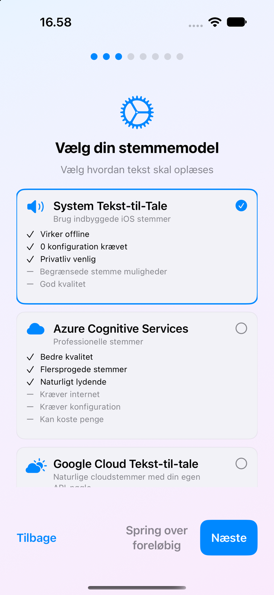

4. På siden **Vælg din stemme**:
   - Har du valgt **System Tekst-til-Tale**, så tryk bare **Næste**. Du behøver ikke trykke **Åbn iOS Indstillinger**. Du kan vælge en anden stemme senere i Wingmate under **Indstillinger → Tale og sprog → Valgt stemme**.
   - Har du valgt en stemme på nettet, så tryk **Vælg stemme**, vælg en stemme, og tryk **Vælg**. Tryk derefter **Næste**. Spørger appen om sprog, så tryk på et sprog. Så går appen selv videre.
5. På siden **Test din stemme** trykker du **Afspil** for at høre en prøve. Tryk **Næste**.
6. Vælg, om du vil slå **Del anonym analysedata** til. Det er slukket fra start. Tryk **Næste**.
7. Tryk **Kom i gang**.

> [!NOTE]
> **Spring over foreløbig** afslutter hele opsætningen med det samme. Så kan du vælge stemme senere under **Indstillinger → Tale og sprog**.

Talehistorik slår du til bagefter under **Indstillinger → Privatliv**.

## De to arbejdsområder

Når opsætningen er færdig, åbner Wingmate det sted, du valgte. Du kan skifte, når du vil:

- Fra Skrivning: tryk på gitter-ikonet øverst til højre. VoiceOver kalder det **Skift til Skærme**. Kan du ikke se knapperne øverst, mens tastaturet er fremme, så se [Skriv og læs op](#skriv-og-læs-op).
- Fra oversigten **Skærme**: tryk på taleboble-ikonet øverst til højre. VoiceOver kalder det **Skift til Skriv**.
- Fra en åben skærm: tryk **Menu** øverst til venstre, og vælg **Skift til Skriv**. Vil du tilbage til oversigten, så vælg **Skærme** i samme menu.

Du kan også vælge, hvor appen skal starte. Gå til **Indstillinger → Generelt**, og vælg under **Åbn ved opstart**: **Tastatur** eller **Skærme**. Vælger du Skærme, kan du også vælge en bestemt skærm eller **Skærmbibliotek** (oversigten over dine skærme).

<!-- SCREENSHOT: iPhone Skrivning with text in the message bar and phrases visible. -->
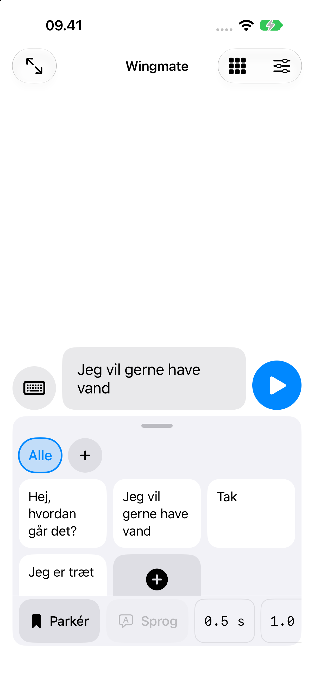

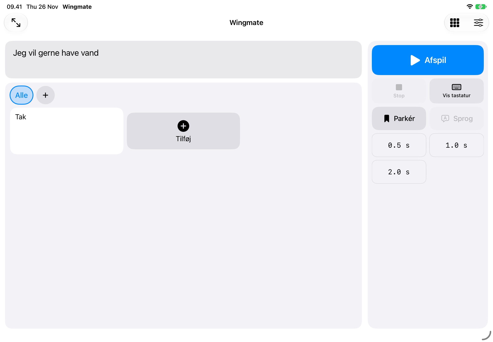

## Skrivning

I Skrivning kan du skrive en ny besked eller trykke på en frase. En frase er et ord eller en besked, du har gemt, fx «Tak».

### Skriv og læs op

- Skriv i feltet **Tekst der skal oplæses**.
- Tryk på den runde afspil-knap (▶), så bliver beskeden læst op. Mens den læser, kan du trykke **Pause**, **Fortsæt** og **Stop**.
- På iPhone: tryk på tastatur-knappen til venstre for tekstfeltet for at få tastaturet frem. Mens tastaturet er fremme, er knappen et plus. Tryk på plusset for at komme tilbage til fraserne og knapperne øverst. VoiceOver kalder knappen **Vis tastatur** eller **Vis skriveskærm**.
- På iPad: tryk **Vis tastatur** i kolonnen til højre. Tryk **Skjul tastatur** samme sted for at skjule tastaturet igen.
- Skriveskærmen viser dine fraser som knapper i stedet for tastaturet.

### Siderne på skriveskærmen

- Du starter som regel på siden **Alle**. Den viser alle dine fraser.
- Hver kategori får sin egen side.
- Er talehistorik tændt, kan siden **Historik** vises.
- **Sandsynligt næste** er en side, der foreslår hele beskeder ud fra det, der er sagt på denne enhed. Den er stadig ny. Du tænder den med **Næste beskeder (eksperimentelt)** under **Indstillinger → Privatliv**.

Skriveskærmen bygger selv sine sider ud fra dine fraser og kategorier. Du kan ikke flytte rundt på siderne eller slette skriveskærmen. Vil du selv bygge sider, bruger du **Skærme**.

### Gem en frase

Tryk på feltet **Tilføj** med plusset nederst blandt dine fraser. Rul ned, hvis du ikke kan se det. VoiceOver kalder feltet **Ny frase**. Så åbner **Ny frase**. (Det runde plus sidst i rækken med kategorier laver en ny kategori.)

Felterne hedder **Titel** og **Udtale**. Pas på, for navnene er byttet om i appen:

- **Udtale** er teksten, der står på frasen. Den skal udfyldes.
- **Titel** er det, der bliver sagt, hvis det skal være noget andet end teksten. Den kan du lade stå tom.

Skriv fx `Jeg vil gerne have vand` i **Udtale**, og lad **Titel** stå tom. Så står den samme tekst på frasen og bliver læst op. Vil du have en kortere tekst på frasen, så skriv `Vand` i **Udtale** og `Jeg vil gerne have vand` i **Titel**.

Under **Symbol** vælger du et billede fra **OpenSymbols** eller **Mine fotos**. Du kan også lave en **Optagelse**. Tryk **Gem**, når du er færdig.

<!-- SCREENSHOT: iPhone phrase sheet with Titel and Udtale. -->
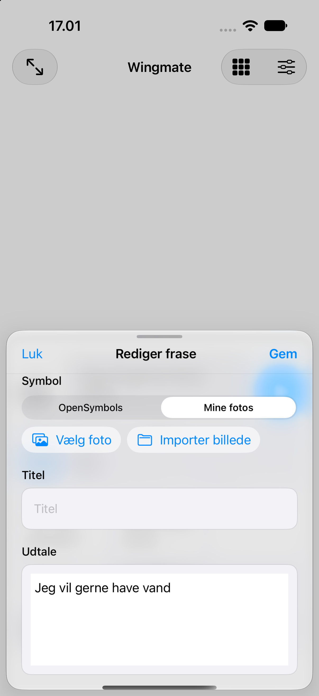

### Ordn dine fraser

- Hold fingeren på en frase, og vælg **Rediger** for at rette den. Træk frasen for at flytte den. Bruger du VoiceOver, kan du også flytte den med handlingerne **Flyt tidligere** og **Flyt senere**.
- Tryk på det runde plus sidst i rækken med kategorier (efter **Alle** og dine egne kategorier) for at lave en kategori. En kategori kan ikke ligge inde i en anden kategori.

> [!TIP]
> Er **Vælg ved berøring** slået til, eller er **Hold for at vælge** over `0`, vises **Rediger** ikke, og du kan ikke trække fraser. Slå **Vælg ved berøring** fra, og sæt **Hold for at vælge** til `0` under **Indstillinger → Tilgængelighed**, mens du retter. Slå dem til igen bagefter.

### Læg en besked til side

Du kan lægge den besked, du er i gang med, til side og starte på en ny. Tryk **Hold** ved bogmærket. På iPhone står knappen i rækken under fraserne, og på iPad i kolonnen til højre. Knappen står på engelsk i denne version. Den gemte tekst vises som **Parkeret:**. Tryk **Byt** for at bytte om på den nye besked og den, der ligger til side.

## Skærme

En **skærm** er et sæt sider med et navn. Der er knapper på siderne, og én side er startsiden. Oversigten hedder **Skærme**.

### Opret en skærm

Sådan laver du en ny skærm:

1. Tryk **Ny skærm** i oversigten **Skærme**.
2. Skriv et **Skærmnavn**.
3. Vælg under **Tavletype**: **Tom tavle**, **QWERTY-tastatur** eller **Alfabetisk tastatur**.
4. Til en tom tavle vælger du, hvor mange **Rækker** og **Kolonner** der skal være (1–12).
5. Tryk **Gem**.

<!-- SCREENSHOT: iPhone new screen sheet with Tavletype. -->
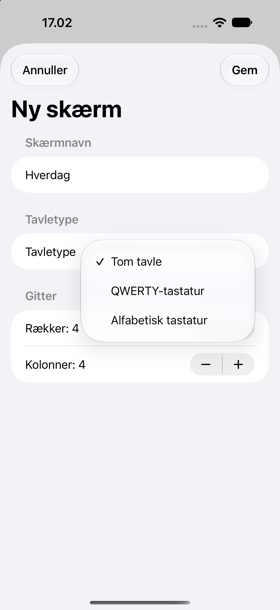

Du kan også lave en skærm ud fra en tale eller en anden tekst:

1. Tryk **Importér tale**.
2. Skriv et navn under **Talens navn**.
3. Sæt teksten ind i det store tekstfelt under **Talens navn**. VoiceOver kalder feltet **Taletekst**. Lav en tom linje mellem de afsnit, der skal have hver sin knap.
4. Vil du give en side et navn, så skriv fx `# Velkomst` på sin egen linje. Linjen bliver ikke læst op.
5. Tryk på **−** eller **+** ved **Afsnit pr. side** for at vælge, hvor mange afsnit der skal være på hver side (1–8). Se resultatet under **Forhåndsvisning**.
6. Tryk **Opret skærm**. Du kan rette skærmen bagefter.

Når du senere trykker på en knap fra **Importér tale**, læser Wingmate hele afsnittet op med det samme. Teksten lægges ikke i beskedlinjen.

På iPhone og iPad kan du ikke hente tavlefiler (`.obf` eller `.obz`) ind i denne version.

Tryk på en skærm i oversigten for at åbne den, eller tryk **Rediger**. Under **Flere handlinger** finder du **Duplikér**, **Lås skærm** / **Lås skærm op**, **Eksportér**, **Eksportér skærm som PDF** og **Slet**.

> [!WARNING]
> En slettet skærm kan ikke hentes tilbage.

### Kommunikér med en skærm

Åbn en skærm, og tryk på knapperne. En knap kan læse op, lægge tekst i beskedlinjen eller åbne en anden side. Det afhænger af, hvordan knappen er sat op.

Er beskedlinjen vist, har den knapper med ikoner. Hvilke knapper der er, afhænger af skærmens indstillinger. Bruger du VoiceOver, hører du deres navne:

- Trekanten (**Afspil**) læser beskeden op. Mens den læser, hedder knappen **Stop**.
- Pilen med et kryds (**Slet sidste**) fjerner den sidste del af beskeden, fx teksten fra den sidste knap, du trykkede på.
- Papirkurven (**Slet alt**) sletter hele beskeden.
- Bogmærket (**Parkér beskeden**) lægger beskeden til side. Ligger der en besked til side, hedder knappen **Byt**.

Har skærmen flere sider, er der en pil (**Forrige side**) og et hus (**Startside**) øverst til højre.

Er **Stryg mellem sider** tændt under **Tilgængelighed**, kan du også stryge: mod venstre for at gå til næste side, og mod højre for at gå til forrige side. Fra den sidste side kommer du ikke til den første ved at stryge, og omvendt. Strygning virker ikke, mens **Vælg ved berøring** eller **Hold for at vælge** er tændt.

Vil du se de skjulte knapper et øjeblik, så tryk **Menu**, og vælg **Vis skjulte knapper midlertidigt**.

<!-- SCREENSHOT: iPhone and iPad board in use with message bar. -->
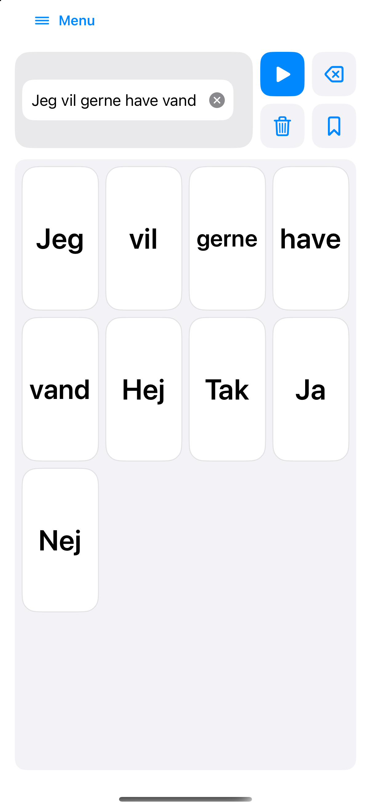

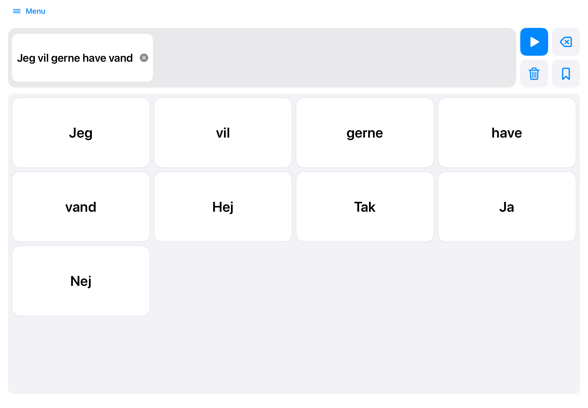

### Rediger sider og knapper

> [!TIP]
> Er du bange for at ødelægge noget? Tryk **Flere handlinger** og **Duplikér** ved skærmen i oversigten først. Så har du en kopi af skærmen, som den var. Når du har gemt en ændring, kan du ikke fortryde den.

Tryk **Rediger** i oversigten, eller tryk **Menu** og **Rediger** på en åben skærm. Er skærmen låst, så tryk **Flere handlinger** ved skærmen i oversigten, og vælg **Lås skærm op** først. Er der sat en redigeringskode, skal den tastes først. Se [Låsning af redigering](#låsning-af-redigering).

Mens du redigerer, kan du ændre knapperne:

- Tryk på **+** i et tomt felt for at lave en ny knap. Skriv fx `Ja` under **Etiket**, og tryk **Gem** øverst.
- Tryk på en knap for at åbne **Rediger felt**. Her kan du ændre knappen og trykke **Gem**, eller fjerne den med **Ryd felt**.
- I **Rediger felt** kan du også flytte knappen og ændre dens størrelse:
  - Under **Flyt** flytter du knappen ét felt ad gangen med pilene. VoiceOver kalder dem **Flyt op**, **Flyt ned**, **Flyt til venstre** og **Flyt til højre**.
  - Under **Størrelse** ændrer du **Bredde** og **Højde** med **−** og **+**. En knap kan kun fylde felter, der er ledige.
- Du kan også holde fingeren på en knap og trække den til et andet felt.
- Skjulte knapper vises, mens du redigerer.

Siderne og skærmen:

- Tryk **Tilføj side** øverst for at lave en ny side.
- Tryk på sidens navn øverst (fx **Home** med en lille pil). Her finder du **Omdøb side**, **Tilpas sidens størrelse**, **Sidebaggrund**, **Sidens baggrundsbillede** og **Sideindstillinger**. På andre sider end startsiden finder du også **Brug som startside** og **Slet side**.
- Tryk på titlen **Redigerer …** øverst. Her finder du **Omdøb skærm** og **Skærmindstillinger**.
- **Tilpas sidens størrelse** ændrer antal rækker og kolonner. Gør du siden mindre, fjernes de knapper, der ikke kan være der. Appen advarer dig først.

Når du er færdig, trykker du **Færdig**.

<!-- SCREENSHOT: iPhone and iPad board in edit mode. -->
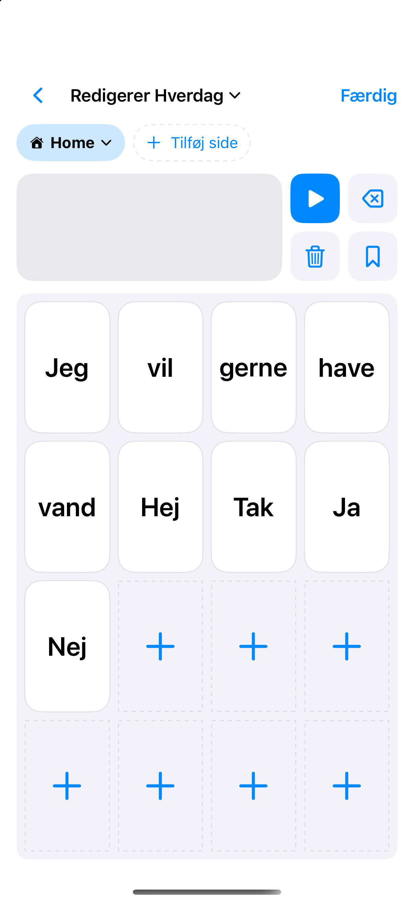

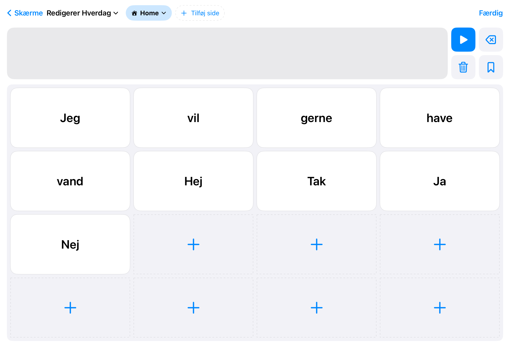

### Symboler, billeder, farver og størrelse

I **Rediger felt** kan du blandt andet sætte:

- **Etiket** – teksten, der står på knappen.
- **Vokalisering** – det, der skal siges, hvis det skal være noget andet end etiketten.
- Et billede. Søg efter et symbol, eller vælg et foto fra enheden. Symbolerne kommer fra OpenSymbols. Det er en samling af billeder, blandt andet fra ARASAAC og Mulberry.
- **Farver**: **Baggrundsfarve** og **Rammens farve**.
- **Knapform** (**Rundet**, **Firkantet**, **Pille**, **Taleboble**, **Tankeboble**) og **Ordtype**. Ordtype kan være **Automatisk**, eller du vælger selv: **Stedord**, **Udsagnsord**, **Beskrivende ord**, **Navneord**, **Socialt ord**, **Andet**.
- **Skjult i brugstilstand** – knappen er der stadig, når du redigerer, men den vises ikke, når du bruger skærmen.
- **Sprog** for den enkelte knap, hvis den skal siges på et andet sprog end det normale.

Ordtypefarver er Fitzgerald-farver. Hver ordtype får sin egen farve, så det er lettere at se, hvad ordet er. De er slukket fra start. Tænd **Automatiske Fitzgerald-ordtypefarver** under **Indstillinger → Visning og layout**. Sætter du selv en farve på knappen, er det den farve, der bruges.

### Sider og navigation

I **Rediger felt** bestemmer du, hvad en knap gør, under **Hvad knappen gør**. Vælg **Tilføj og udtal** eller **Åbn side**. Vælger du **Åbn side**, trykker du **Vælg en side** under **Forbundet side**. Har skærmen kun én side, så lav først den nye side med **Tilføj side**.

**Særlige handlinger** kan lægges på en knap:

- **Stav etiketten**
- **Mellemrum**
- **Slet tegn**
- **Ryd sætning**
- **Gå til startsiden**
- **Læs sætningen op**
- **Ordforslag**

Har du tændt flere handlinger, kan du ændre rækkefølgen med **Flyt handling op** og **Flyt handling ned**.

Du kan også bestemme, hvad der sker, når du har trykket på en almindelig knap. Under **Efter valg** vælger du **Bliv på denne side**, **Gå tilbage til forrige side** eller **Gå til startsiden**. Du vælger det for hele skærmen under **Skærmindstillinger** og kan vælge noget andet for en enkelt side under **Sideindstillinger**.

### Skærm- og sideindstillinger

Åbn skærmen til redigering (se [Rediger sider og knapper](#rediger-sider-og-knapper)). Tryk på titlen **Redigerer …** for **Skærmindstillinger**, eller på sidens navn for **Sideindstillinger**. Her kan du blandt andet:

- slå **Vis etiketter** og **Vis symboler** til eller fra, og vælge **Etikettens placering** (**Øverst** eller **Nederst**), når begge vises
- tænde eller slukke **Beskedlinje**, **Oplæsningsknap i beskedlinjen** og **Redigerbar beskedlinje**
- vælge **Aktivering af knap**: **Læs op og tilføj**, **Tilføj uden oplæsning** eller **Læs op uden at tilføje**
- vælge **Efter valg** (bliv, forrige side eller startside)
- tænde **Forudindlæs tale**. Så laver Wingmate lyden til alle knapper på forhånd med den stemme, du har valgt på nettet. Det koster hos den, der leverer stemmen, og det fylder på enheden. Det er slukket fra start.

Sidens baggrund vælger du i menuen under sidens navn: **Sidebaggrund** og **Sidens baggrundsbillede**. Billedet kan fylde hele siden (**Udfyld**) eller vises helt (**Tilpas**).

En skærm kan følge appen med **Brug appstandard**, og en side kan følge skærmen med **Brug skærmindstilling**. **Nulstil skærmindstillinger** og **Nulstil sidetilpasninger** fjerner dine egne valg.

## Låsning af redigering

Der er to låse. Begge stopper kun redigering. Du kan altid tale.

### Redigeringskode for hele appen

**Redigeringsadgang** er en valgfri kode til hele appen. Du finder den under **Indstillinger → Generelt**.

1. Tryk **Kræv redigeringskode**.
2. Tast en kode på 4 til 8 cifre, og tryk på fluebenet (✓) nederst til højre. VoiceOver kalder det **OK**.
3. Tast den samme kode igen, og tryk på fluebenet (✓).

Bagefter kan du trykke **Skift redigeringskode** eller **Deaktivér redigeringskode**.

- Taster du forkert flere gange, venter appen, før du kan prøve igen («For mange forsøg. Vent et øjeblik, og prøv igen.»).
- Wingmate bruger kun denne kode med tal. Den bruger ikke Face ID, Touch ID eller enhedens egen kode.
- Koden kommer ikke med i en sikkerhedskopi. Efter en gendannelse skal du sætte koden igen, hvis du vil bruge den.

> [!WARNING]
> Wingmate kan ikke nulstille en glemt redigeringskode. Skriv koden ned, og gem den et sikkert sted.

### Lås på en enkelt skærm

**Lås skærm** fryser sider og knapper på en skærm. Du finder **Lås skærm** og **Lås skærm op** under **Flere handlinger** ved skærmen i oversigten **Skærme**. Sider og knapper kan ikke ændres, før du trykker **Lås skærm op**. Er redigeringskoden tændt, skal den tastes for at låse eller låse op. En låst skærm har en hængelås i øverste højre hjørne i oversigten, og **Rediger** er grå. VoiceOver læser den som **Låst**. Du kan stadig åbne den og tale.

## Stemmer

Du vælger, hvad der skal tale, i opsætningen eller under **Indstillinger → Tale og sprog → Talemotor**. Stemmerne hedder ikke det samme de to steder:

| I opsætningen | I indstillingerne | Hvad du får | Skal du være på nettet? |
| --- | --- | --- | --- |
| **System Tekst-til-Tale** | **System** | De indbyggede stemmer på iPhone og iPad, også en personlig stemme, du selv har lavet på enheden. | Kan virke uden net. Nogle stemmer på enheden bruger alligevel internet. |
| **Azure Cognitive Services** | **Azure** | Naturlige stemmer fra Microsoft. Du bruger din egen nøgle. | Kræver internet. Dine ord sendes til Microsoft. Det kan koste penge. |
| **Google Cloud Tekst-til-tale** | **Google** | Stemmer fra Google. Du bruger din egen nøgle. | Kræver internet. Dine ord sendes til Google. Det kan koste penge. |
| **ElevenLabs** | **ElevenLabs** | Stemmer fra din ElevenLabs-konto, også en kopi af en stemme, du selv har lavet der. | Kræver internet. Dine ord sendes til ElevenLabs. Det tæller med i din konto. |

En stemme på enheden kræver ingen nøgle. Stemmerne på nettet kræver en nøgle, du selv laver hos Microsoft, Google eller ElevenLabs. Wingmate gemmer nøglen sikkert på enheden. Den kommer ikke med i en sikkerhedskopi.

Sådan sætter du en stemme på nettet op:

1. Gå til **Indstillinger → Tale og sprog**. Vælg **Azure**, **Google** eller **ElevenLabs** under **Talemotor**.
2. Tryk **Opsæt Azure Speech**, **Google Cloud Tekst-til-tale** eller **Opsæt ElevenLabs**, og følg trinene på skærmen.
3. Sæt nøglen ind. Til Azure skal du også udfylde **Endpoint eller region**.
4. Tryk **Gem sikkert og bekræft** (Google og ElevenLabs) eller **Gem og fortsæt** (Azure). Ved Google og Azure trykker du derefter **Færdig**.

Virker nøglen ikke, beholder Wingmate den gamle opsætning.

Derefter vælger du en stemme under **Valgt stemme** og et **Sprog**. Ved stemmer på nettet trykker du **Vælg**, når du har valgt stemmen. Kan stemmen tale flere sprog, kan du også vælge et **Andet sprog**.

Vil du have ElevenLabs til at tale langsommere, så skriv et engelsk ord i firkantede klammer foran teksten, for eksempel `[slowly]`.

Er stemmen på nettet ikke til at få fat i, læser enhedens stemme op i stedet. Wingmate siger, at stemmen på nettet ikke var tilgængelig. Beskeden bliver ikke slettet.

Under **Udtaleordbog** kan du lære Wingmate, hvordan navne og ord skal siges. Ordbogen virker ikke med ElevenLabs.

Vil du vide mere om nøgler og stemmer, så se [elevenlabs-tts.md](elevenlabs-tts.md) og [google-cloud-tts.md](google-cloud-tts.md) (på engelsk).

<!-- SCREENSHOT: iPhone Settings → Tale og sprog. -->
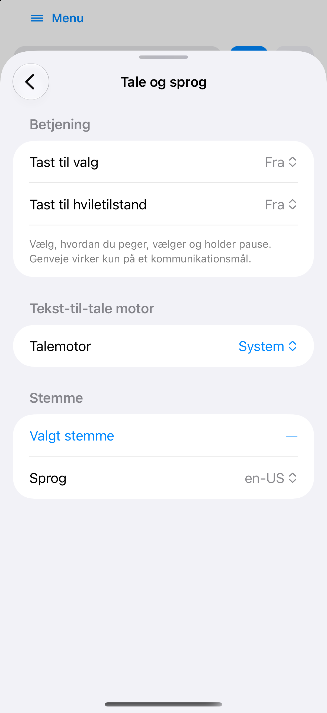

## Eksport og udskrift

Vil du flytte en skærm til en anden enhed eller en anden ASK-app, sender du den som en fil. Wingmate har ingen konto, der gemmer dine skærme.

### Send en skærm ud

1. Åbn skærmen.
2. Tryk **Menu**, og vælg **Eksportér**.
3. Vælg, hvad du vil lave:
   - **Open Board (.obz)** – skærmen i en fil, som andre ASK-apps også kan læse.
   - **Eksportér til Grid** – en fil til Smartbox Grid 3. I Grid Explorer vælger du **Add Grid Set → Grid set file**. Se [Smartbox’ vejledning til Grid Explorer](https://hub.smartboxaac.com/knowledgebase/grid-explorer-in-grid-3/) (på engelsk).

Vil du udskrive skærmen, laver du en PDF. Tryk **Menu**, og vælg **Eksportér skærm som PDF**. Du får som regel ét liggende A4-ark pr. side. En knap, der går til en anden side, får skrevet, hvilken side den går til.

### Hvad følger med til Grid

Siderne følger med, og det samme gør knappernes plads og størrelse, tekster, det der skal siges, farver og de billeder og lyde, Grid kan afspille. Er beskedlinjen tændt, lægger Wingmate en talerække øverst i Grid. Optagelser, som Grid kan afspille, afspilles, når knappen vælges. En samlet besked sendes som tekst.

Det her følger ikke med til Grid: ordforslag i Wingmate, ekstra elementer på siden, baggrundsbilleder og et særligt stemmevalg på den enkelte knap. Wingmate kan sende en skærm til Grid. Den kan ikke hente en Grid-fil ind igen.

Skriveskærmen kan ikke sendes ud. Det er kun dine egne skærme.

## Sikkerhedskopi

En sikkerhedskopi gemmer dine skærme, fraser, indstillinger og meget mere fra *denne* enhed i én fil. Brug den til at flytte til en ny enhed eller til at passe på dine ting. Vil du dele en enkelt skærm med andre, så brug [Eksport og udskrift](#eksport-og-udskrift) i stedet.

Du finder **Sikkerhedskopiér Wingmate** under **Indstillinger → Privatliv**.

- **Opret sikkerhedskopi** gemmer eller deler en fil. Den ender på `.wingmate-backup`.
- **Gendan sikkerhedskopi**: vælg filen, og tryk **Validér og erstat**. Wingmate tjekker filen og erstatter så de data, der ligger på enheden nu. Tryk **Annuller**, hvis du vil beholde dine nuværende data.

Kopien kan indeholde skærme, sider, fraser, kategorier, billeder, optagelser, indstillinger, talehistorik, stemmevalg og udtaleordbog. Dit valg af stemme kommer med. Bruger du Azure, kommer regionen også med, men ikke selve nøglen. Redigeringskoden og midlertidige lydfiler kommer heller ikke med. Efter en gendannelse skal du sætte nøglen og en eventuel redigeringskode op igen.

> [!WARNING]
> Filen er ikke låst med en kode, og den kan indeholde dine beskeder. Gem den et sikkert sted.

Vil du se, hvordan filen er bygget op, så læs [BACKUP_FORMAT.md](BACKUP_FORMAT.md) (på engelsk).

<!-- SCREENSHOT: iPhone Privatliv with Sikkerhedskopiér Wingmate. -->
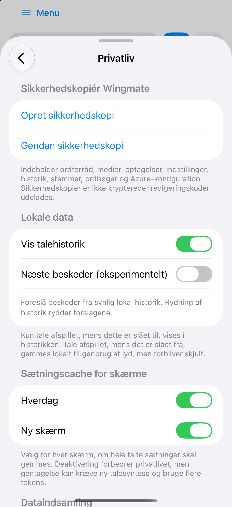

## Indstillinger

I Skrivning og i oversigten **Skærme** åbner du **Indstillinger** med ikonet med skydeknapper øverst til højre. VoiceOver kalder det **Indstillingspanel**. På en åben skærm trykker du **Menu** og vælger **Indstillingspanel**. Du kan søge med **Søg i indstillinger**. **Udtaleordbog** er sit eget punkt på forsiden af **Indstillinger**.

| Afsnit | Her finder du blandt andet |
| --- | --- |
| **Tale og sprog** | **Betjening** (**Tast til valg**, **Tast til hviletilstand**), **Talemotor**, stemme og sprog |
| **Visning og layout** | **Partnerskærm**, knaptekster og symboler, gitter, **Høj kontrast**, **Automatiske Fitzgerald-ordtypefarver**, størrelse, beskedlinje |
| **Tilgængelighed** | **Berøring og timing**, **Feedback og logning** (med **Tale ved valg**), **Markørfremhævning**, **Scanning** |
| **Privatliv** | **Vis talehistorik**, **Næste beskeder (eksperimentelt)**, **Sætningscache for skærme**, **Dataindsamling** (**Rapportering af funktionsbrug**, **Standardiseret logning (OBL)**), sikkerhedskopi |
| **Generelt** | **Åbn ved opstart**, **Redigeringsadgang**, **Genstart opsætningsguide** |

Andre valg, der er gode at kende:

- **Tale ved valg** (under **Tilgængelighed**): **Straks** eller **Kun sætning**. Ved **Kun sætning** er appen stille, indtil den samlede besked læses op.
- **Vis talehistorik**: kun tale, der afspilles, mens dette er tændt, vises i historikken. Tale, der afspilles, mens det er slukket, vises ikke, men lyden kan stadig være gemt på enheden, så den kan bruges igen.
- **Rapportering af funktionsbrug**: valgfri, og slukket fra start. Ingen tekst, nøgler, filstier eller skærmindhold sendes. Se [PRIVACY_POLICY.md](../PRIVACY_POLICY.md) (på engelsk).
- **Standardiseret logning (OBL)**: en liste over brugen, som en terapeut kan gennemgå. Listen bliver på enheden.
- **Partnerskærm** (under **Visning og layout**) kan vise beskeden med stor tekst på en tilsluttet skærm, der vender ud mod den, du taler med. Valgene er **Fra**, **Kun ved oplæsning** og **Under skrivning og oplæsning**. Partnerskærmen er skjult under den første opsætning, i indstillingerne, mens redigeringskoden tastes, og mens du redigerer.
- **Genstart opsætningsguide** under **Generelt** kører den første opsætning igen.

<!-- SCREENSHOT: iPhone and iPad Settings overview. -->
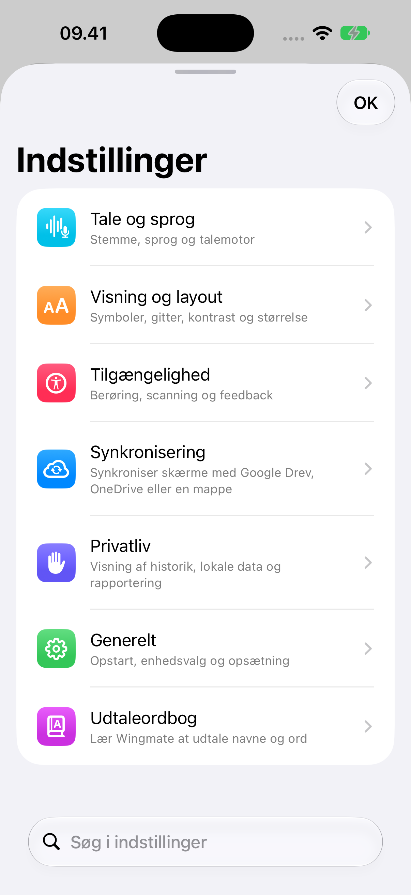

## Tilgængelighed og betjening

Under **Tilgængelighed** kan du ændre, hvordan der peges og vælges. Tiderne står i millisekunder (ms). 1000 ms er 1 sekund. **Tast til valg** og **Tast til hviletilstand** ligger under **Betjening** øverst i **Indstillinger → Tale og sprog**.

- **Hold for at vælge** – knappen vælges først, når du har holdt fingeren nede så længe. Vælg `0` for at slå det fra. Mens det er slået til, kan du ikke stryge mellem sider.
- **Dvæl for at vælge** – knappen vælges, når markøren bliver stående på den, uden at du klikker. `0` slår det fra.
- **Vælg ved berøring** – knappen vælges, så snart du rører den, ikke når du slipper. Knapfelterne ruller ikke længere. **Hold for at vælge** gælder stadig, hvis det er tændt. Mens det er slået til, kan du ikke stryge mellem sider.
- **Stryg mellem sider** – stryg mod venstre for at gå til næste side, og mod højre for at gå til forrige side.
- **Markeringsde-bounce** – ignorerer hurtige tryk på den samme knap lige efter hinanden.
- **Markeringsfremhævning** og **Lyd ved valg** – en kort ramme og en lyd, når en knap er valgt.
- **Auditiv søgning** – Wingmate hvisker knappens tekst, når du rører knappen eller holder markøren over den.
- **Tast til valg** (under **Tale og sprog → Betjening**) – vælg en tast: **Space**, **Enter**, **F8** eller **F9**. Når du trykker på den, vælges den knap, markøren eller tastaturet står på.
- **Tast til hviletilstand** (under **Tale og sprog → Betjening**) – vælg en tast, der sætter **Dvæl for at vælge** og **Tast til valg** på pause. Når **Dvæl for at vælge** eller **Tast til valg** er tændt, er der også en rund pause-/afspil-knap nederst til højre. VoiceOver kalder den **Hviletilstand** eller **Genoptag input**. Almindelige tryk virker stadig, mens der hviles. Tryk på knappen eller på hviletasten for at starte igen. Bruger du **Tast til valg**, kan du også holde den nede i 2 sekunder.
- **Markørfremhævning** – behold den almindelige markør, eller læg en tydelig ring eller et omrids ovenpå. Under **Markørstil** er valgene **System**, **Ring** og **Omrids**.

### Scanning

Bruger du en kontakt, er det iPhone og iPad selv, der flytter markeringen rundt på skærmen. Wingmate bestemmer, hvilke dele af skærmen markeringen kommer forbi, og i hvilken rækkefølge.

1. Tilslut din kontakt, og sæt **Knapbetjening** op i iPhone- eller iPad-appen **Indstillinger** (ikke i Wingmate) under **Tilgængelighed → Knapbetjening**. Følg [Apples vejledning](https://support.apple.com/da-dk/119835), og slå **Knapbetjening** til.
2. Åbn **Indstillinger → Tilgængelighed** i Wingmate. Rul ned til **Scanning**, og slå **Aktiver scanning** til.
3. Vælg de områder, du vil kunne vælge med din kontakt: **Afspilningsområde**, **Inputfelt**, **Frasegitter**, **Kategori-elementer** og **Toplinje/indstillinger**.
4. Under **Frasegitter-rækkefølge** vælger du, om fraserne skal gennemgås **Rækkevis**, **Kolonnevis** eller **Lineær**.

**Dvæl (s)** og **Auto-frem (s)** har ingen virkning i denne version. Tiderne sætter du i stedet under **Knapbetjening** i iPhone- eller iPad-appen **Indstillinger**.

<!-- SCREENSHOT: iPhone Scanning settings. -->
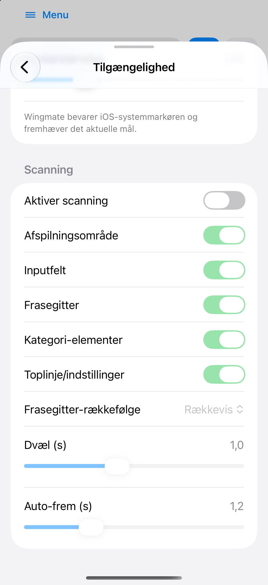

### Styring med øjne, hoved og kontakt

Wingmate kan bruges med finger, mus, pegefelt, tastatur, kontakt og den markør, systemet stiller til rådighed. iPhone og iPad har selv funktioner til at styre med øjnene, hovedet, en kontakt (**Knapbetjening**) eller stemmen. Du slår dem til i iPhone- eller iPad-appen **Indstillinger** under **Tilgængelighed**. Se [HEAD_EYE_TRACKING.md](HEAD_EYE_TRACKING.md) (på engelsk).

## Fejlfinding

**Stemmen på nettet virker ikke.** Tjek, at du har internet, og at nøglen stadig virker. Wingmate bruger enhedens stemme i stedet og beholder beskeden. Er nøglen blevet ændret, så sæt den nye ind under **Indstillinger → Tale og sprog**.

**Stemmerne på enheden mangler eller lyder forkert.** Vælg stemmen i Wingmate under **Indstillinger → Tale og sprog → Valgt stemme**. Mangler stemmen på listen, så hent den i iPhone- eller iPad-appen **Indstillinger** (ikke i Wingmate) under **Tilgængelighed → Oplæst indhold → Stemmer**. Gå tilbage til Wingmate, og vælg den.

**Jeg kan ikke hente en tavlefil ind.** Det kan man ikke på iPhone og iPad i denne version. Brug **Importér tale**, eller byg skærmen i Wingmate.

**Skærmen kan ikke redigeres.** Se i oversigten **Skærme**, om skærmen har en hængelås, og om redigeringskoden er tændt. Tryk **Flere handlinger** ved skærmen, vælg **Lås skærm op**, og tast koden, hvis der bliver spurgt om den.

**Jeg har glemt redigeringskoden.** Koden ligger kun på enheden og kommer ikke med i en sikkerhedskopi. Wingmate kan ikke nulstille den for dig. Sidder du fast, så skriv til udvikleren. Se [Giv feedback](#giv-feedback).

**Historik eller «Sandsynligt næste» vises ikke.** Gå til **Indstillinger → Privatliv**. Tænd **Vis talehistorik**, og tænd derefter **Næste beskeder (eksperimentelt)**. Læs en besked op, så vises **Historik**. Læs endnu en anden besked op. Når Wingmate har noget at foreslå, vises **Sandsynligt næste** også. Når tastaturet er fremme, vises forslagene også i en række over tastaturet.

**Søgningen finder ingen symboler, eller den er langsom.** Søgningen kræver net. Har du søgt mange gange lige efter hinanden, beder appen dig vente og prøve igen.

**Appen er på et andet sprog end forventet.** Appen bruger enhedens sprog, hvis det findes i Wingmate. Dansk findes.

## Giv feedback

Fejl, ønsker og spørgsmål kan sendes som en sag på GitHub: [github.com/Jdreioe/Wingmate/issues](https://github.com/Jdreioe/Wingmate/issues).

Du kan også skrive til [wingmate@dreioe.dk](mailto:wingmate@dreioe.dk).

Når du beskriver et problem, så skriv gerne om du bruger iPhone eller iPad, hvilken version af appen du har, og om det sker i Skrivning eller Skærme.

## Om denne manual

Wingmate er gratis, og koden er åben: [github.com/Jdreioe/Wingmate](https://github.com/Jdreioe/Wingmate). Licens: GPL 3.0.

Manualen beskriver Wingmate, som den så ud i commit [`ab4a8e2`](https://github.com/Jdreioe/Wingmate/commit/ab4a8e242126a2dc2a978e52f5e077038a6770e2) på `main` (25. november 2026). Udgivelsen er version 1.9.1 på TestFlight.

Der er ikke en udgave til computer i denne version. Den ældre computerudgave ligger under [`desktop-archive`](https://github.com/Jdreioe/Wingmate/tree/desktop-archive).
