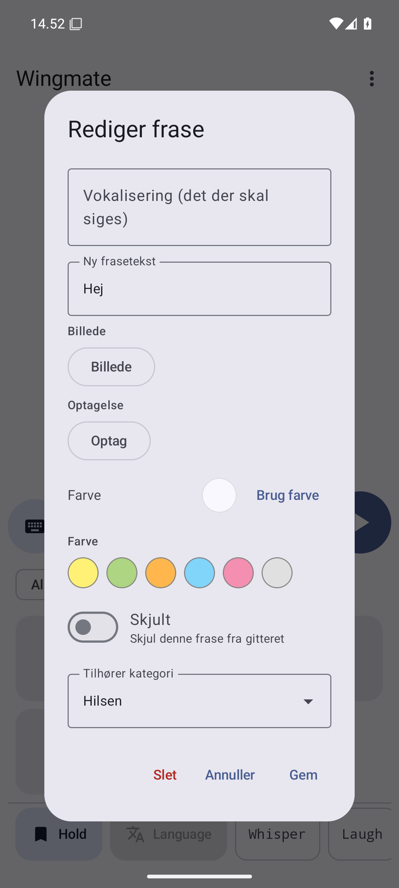
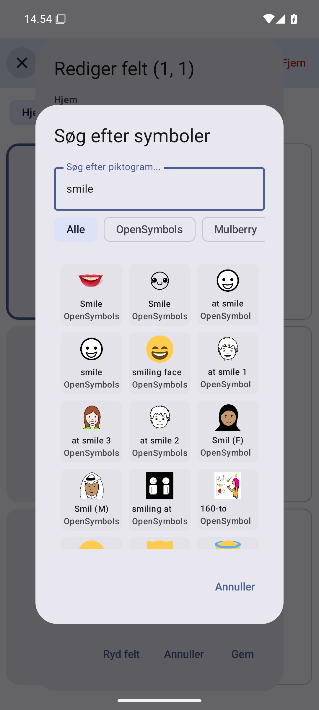

# Wingmate – manual til nye brugere

Denne manual beskriver Wingmate, som koden så ud i commit [`ab4a8e2`](https://github.com/Jdreioe/Wingmate/commit/ab4a8e242126a2dc2a978e52f5e077038a6770e2) på `main` (25. november 2026, Europe/Copenhagen). Versionsnummeret i kilden er **1.9.0** på Android (`version.properties`) og **1.9.1** på iPhone og iPad (`iosApp/Configuration/Config.xcconfig`). Seneste udgivelsestags i depotet er `v1.9.0` (Android) og `staging/1.9.1` (iOS TestFlight).

Manualen er skrevet til kommunikatoren og til familiemedlemmer, hjælpere og terapeuter, der hjælper med at sætte Wingmate op. Appen vises på dansk, når enhedens sprog er dansk. Knap- og menunavne er citeret, som de står i den danske oversættelse. Hvor Android og iPhone/iPad bruger forskellige tekster, er det nævnt.

Licens: GPL 3.0. Kildekode: [github.com/Jdreioe/Wingmate](https://github.com/Jdreioe/Wingmate).

Billederne er taget i Android-udgaven med dansk brugerflade.

## Indhold

- [Hvad er Wingmate](#hvad-er-wingmate)
- [Installation](#installation)
- [Første start](#første-start)
- [De to arbejdsområder](#de-to-arbejdsområder)
- [Skrivning](#skrivning)
- [Skærme](#skærme)
  - [Opret eller importér en skærm](#opret-eller-importér-en-skærm)
  - [Kommunikér med en skærm](#kommunikér-med-en-skærm)
  - [Rediger sider og knapper](#rediger-sider-og-knapper)
  - [Symboler, billeder, farver og størrelse](#symboler-billeder-farver-og-størrelse)
  - [Sider og navigation](#sider-og-navigation)
  - [Skærm- og sideindstillinger](#skærm--og-sideindstillinger)
- [Låsning af redigering](#låsning-af-redigering)
- [Stemmer](#stemmer)
- [Import og eksport](#import-og-eksport)
- [Sikkerhedskopi](#sikkerhedskopi)
- [Indstillinger](#indstillinger)
- [Tilgængelighed og betjening](#tilgængelighed-og-betjening)
- [Fejlfinding](#fejlfinding)
- [Giv feedback](#giv-feedback)

## Hvad er Wingmate

Wingmate er en gratis, open source-app til alternativ og supplerende kommunikation (ASK). Den er udviklet af Jonas Dreiøe, som selv har cerebral parese og bruger kommunikationshjælpemidler.

Der er to ligestillede arbejdsområder:

- **Skrivning** – skriv frit, brug gemte fraser og kategorier, og få beskeden læst op.
- **Skærme** – kommunikér med symboler og knapper på sammenkædede sider (et sidesæt).

Beskeden, du er i gang med, følger med, når du skifter arbejdsområde, lukker appen eller genstarter enheden, indtil den bliver ryddet. Data ligger på enheden, medmindre du selv vælger en online stemmetjeneste eller en symbol-søgning, der kræver netværk. Wingmate synkroniserer ikke automatisk mellem enheder.

## Installation

### Android

Hent Wingmate fra [Google Play](https://play.google.com/store/apps/details?id=com.hojmoseit.wingmate) (pakkenavn `com.hojmoseit.wingmate`). Appen kræver Android 7.0 eller nyere. Den er gratis og uden køb i appen.

### iPhone og iPad

Wingmate er endnu ikke i App Store. Den installeres via Apples testprogram TestFlight:

1. Installér appen [TestFlight](https://apps.apple.com/app/testflight/id899247664) fra App Store.
2. Åbn invitationslinket: [testflight.apple.com/join/A3gQrMvE](https://testflight.apple.com/join/A3gQrMvE).
3. Følg anvisningerne i TestFlight for at installere **Wingmate AAC**.

Projektet er sat til iOS og iPadOS 18.0 eller nyere. En TestFlight-version kan bruges i op til 90 dage ad gangen; når der kommer en ny build, opdaterer TestFlight typisk appen.

### Computer

En desktop-udgave er sat på pause og ligger kun som arkiv under tagget [`desktop-archive`](https://github.com/Jdreioe/Wingmate/tree/desktop-archive). Den indgår ikke i den aktuelle udgivelse.

## Første start

Første gang du åbner Wingmate, kører en guidet opsætning. Du kan ændre alle valg senere i **Indstillinger**. På Android kan du allerede her vælge **Gendan en sikkerhedskopi**, hvis du flytter data fra en anden enhed.

Opsætningen beder dig typisk om at:

1. Vælge, hvad der skal tale for dig (se [Stemmer](#stemmer)).
2. Vælge en stemme og et sprog, og høre en prøve. Du kan justere **Hastighed**.
3. Vælge, hvordan du vil kommunikere:
   - Android: **Skrivning** («Skriv beskeder, og tryk på gemte fraser») eller **Skærme** («Tryk på symboler på sider. Opret eller importér en skærm for at starte»).
   - iPhone og iPad: **Tastatur og fraser** eller **Skærme**. På iOS følger en kort rundvisning.
4. Gennemgå privatlivsvalg, blandt andet om talehistorik skal vises, og om du vil **Del anonym analysedata**. Analysedata er slået fra som standard og indeholder ikke dine ord eller nøgler.

På Android afsluttes opsætningen med **Begynd at kommunikere**. På iPhone og iPad bruges blandt andet **Næste**, **Kom i gang** og **Spring over foreløbig**.

<!-- SCREENSHOT: Android welcome step “Hvad skal tale for dig?” with the four engine options visible: Denne enhed, Microsoft Azure, Google Cloud, ElevenLabs. -->

<!-- SCREENSHOT: Android welcome step “Hvordan vil du kommunikere?” showing the two cards Skrivning and Skærme. -->

## De to arbejdsområder

Når opsætningen er færdig, åbner Wingmate i det område, du valgte. Du kan skifte når som helst:

- Fra Skrivning: **Skift til skærme** (Android) eller **Skift til Skærme** (iPhone og iPad).
- Fra Skærme: **Skift til tastatur og fraser** (Android) eller **Skift til Skriv** (iPhone og iPad).

Under **Indstillinger** kan du vælge, hvad der skal **Åbn ved opstart**: **Tastatur** eller **Skærme**. Hvis du vælger Skærme, kan du også vælge en bestemt skærm eller **Skærmoversigt** / **Skærmbibliotek**.

<!-- SCREENSHOT: Typing workspace in communication use: message bar with some text, phrase grid or Typing Screen visible, and the control to switch to Screens visible in the toolbar or menu. Android preferred if labels differ. -->

<!-- SCREENSHOT: Screens library (Skærme) with the title “Skærme”, at least one screen card, and actions such as Ny skærm / Opret skærm and Importer skærm / Importér tale visible. -->

## Skrivning

I Skrivning skriver du en besked og kan supplere med gemte fraser.

- Skriv i feltet **Indtast tekst der skal tales** (Android). Tryk på afspil for at få beskeden læst op. Under oplæsning kan du bruge **Pause**, **Fortsæt** og **Stop**.
- Skift mellem **Vis tastatur** og **Vis skriveskærm**. Skriveskærmen viser fraserne i et gitter. Dens indbyggede layout kan ikke redigeres, nulstilles eller slettes.
- På skriveskærmen starter du typisk på siden **Alle**. Hver kategori får sin egen side. Hvis talehistorik er slået til, kan siden **Historik** vises. **Sandsynligt næste** er en eksperimentel side, der foreslår hele beskeder ud fra historikken på denne enhed; den slås til under **Indstillinger → Privatliv**.
- Gem en frase med **+** eller feltet **Tilføj** på iPhone og iPad. Dialogen hedder **Ny frase**. På Android trykker du på **Tilføj ny frase** på skriveskærmen.
- På Android kan du sætte **Vokalisering (det der skal siges)**, billede (**Foto** eller **Symbol**), **Farve**, en personlig **Optagelse** og hvilken kategori frasen tilhører. Du kan markere den som **Skjult**, så den ikke vises i gitteret.
- På iPhone og iPad hedder felterne **Titel** og **Udtale**. Teksten under **Udtale** er den, der vises på frasen. Teksten under **Titel** er det, der siges, hvis du udfylder den. Billede vælger du under **Symbol** som **OpenSymbols** eller **Mine fotos**. Du kan også lave en **Optagelse**. Farve, kategori og **Skjult** findes ikke i dette ark.
- Hold nede på en frase for at redigere den, eller træk for at flytte den. På iPhone og iPad kan du også flytte den med **Flyt tidligere** og **Flyt senere**, hvis de knapper vises.
- Organiser fraser i kategorier (**Tilføj kategori**). Kategorier kan ikke ligge inde i hinanden.
- Du kan parkere den aktuelle besked og starte på en ny. Den parkerede tekst vises som **Parkeret:**, og **Byt** bytter om på den aktive og den parkerede besked.

<!-- SCREENSHOT: Phrase editor dialog/sheet open (Tilføj ny frase or Rediger frase on Android; Ny frase on iOS) showing fields for text, vocalization, image (Foto / Symbol), color, and category. -->

Ordforslag bogstav for bogstav, som man kender fra nogle tastaturer, findes i koden, men er i denne udgave begrænset til fejlretningsbygger og er ikke en udgivet funktion i Skrivning.

## Skærme

En **skærm** er et navngivet sidesæt: flere sider med knapper, hvor én side er startsiden. Oversigten hedder **Skærme** («Vælg en skærm til kommunikation»).

### Opret eller importér en skærm

- **Ny skærm** / **Opret skærm** opretter et nyt sidesæt. Du giver det et **Skærmnavn**.
- Skabeloner:
  - Android: **Tom**, **Lommeregner** eller **Tastatur** (layout **QWERTY** eller **Alfabetisk**). Til en tom skærm vælger du antal **Rækker** og **Kolonner**.
  - iPhone og iPad: under **Tavletype** vælger du **Tom tavle**, **QWERTY-tastatur** eller **Alfabetisk tastatur**. Skabelonen Lommeregner findes ikke på iPhone og iPad. Til en tom tavle vælger du **Rækker** og **Kolonner** (1–12).
- **Importer skærm** åbner en `.obf`- eller `.obz`-fil (Open Board Format). Adgangskodebeskyttede filer kan ikke importeres; eksportér dem først uden adgangskode.
- **Importér tale** laver en redigerbar skærm ud fra indsat tekst. En tom linje starter en ny knap. Markdown-overskrifter navngiver sider og bliver ikke læst op. I forhåndsvisningen kan du samle eller dele afsnit og vælge, hvor mange afsnit der skal være på hver side (1–8), før du trykker **Opret skærm**. En knap læser hele afsnittet op med det samme og lægger det ikke i beskedlinjen.

Fra oversigten kan du **Åbn**, **Rediger**, **Dupliker**, **Lås** / **Lås op** (på iOS: **Lås skærm** / **Lås skærm op**) og slette en skærm. Sletning kan ikke fortrydes.

<!-- SCREENSHOT: New screen dialog on Android, showing template choices Tom, Lommeregner and Tastatur, plus name and grid size fields for a blank screen. -->

<!-- SCREENSHOT: Importér tale sheet with sample pasted text, paragraph-per-page control, and a preview of generated pages. -->

### Kommunikér med en skærm

Åbn en skærm og tryk på knapperne. Afhængigt af indstillinger og knaptype kan en knap læse op, lægge tekst i beskedlinjen, eller åbne en anden side.

Hvis **Beskedlinje** er vist, kan du typisk læse beskeden op, slette det sidste og rydde det hele.

- Android: knapperne hedder **Afspil**, **Slet ord** og **Ryd**, når der er plads til tekst. På en smal skærm er de ikoner. Skærmlæsere hører **Læs sætningen op**, **Slet sidste ord** og **Ryd sætningen**.
- iPhone og iPad: knapperne hedder **Afspil** (og **Stop**, mens der læses op), **Slet sidste** og **Slet alt**. Du kan også **Parkér beskeden**.

**Forrige side** og **Startside** går tilbage i historikken eller til start. Hvis **Stryg mellem sider** er slået til under tilgængelighed, kan du også stryge vandret til nabosiden. Første og sidste side går ikke rundt. På iPhone og iPad virker sidestrygning ikke, mens **Vælg ved berøring** eller **Hold for at vælge** er slået til. På Android bliver sidestrygning ikke slået fra af de to funktioner i denne udgave, selv om hjælpeteksten nævner **Vælg ved berøring**.

<!-- SCREENSHOT: An open Screen in communication (not editing) mode: a grid of symbol buttons, message bar at the top or bottom with a short composed message, and page navigation (Forrige side / Startside) visible. Prefer a simple child-friendly board if one can be created quickly, otherwise a blank grid with a few labeled buttons. -->

### Rediger sider og knapper

Vælg **Rediger** / **Rediger skærm**. En låst skærm skal først låses op («Lås skærmen op før redigering»). Hvis der er sat en redigeringskode, skal den indtastes først (se [Låsning af redigering](#låsning-af-redigering)).

I redigering:

- Hold nede på en knap for **Rediger**, **Tilpas størrelse** eller **Fjern**. Du kan også trække knappen til et andet felt.
- På iPhone og iPad kan du flytte og ændre størrelse felt for felt med **Flyt op/ned/venstre/højre** og **Bredere**, **Smalere**, **Højere**, **Lavere**. En knap kan dække flere felter, hvis de er ledige.
- **Tilføj side** opretter en ny side. **Brug som startside** gør den aktuelle side til start. **Tilpas sidens størrelse** ændrer antal rækker og kolonner; felter uden for den nye størrelse skal flyttes (Android) eller fjernes (advarsel på iOS), før siden kan gøres mindre.
- **Vis skjulte knapper midlertidigt** viser knapper, der er markeret som skjulte, mens du redigerer.
- **Afslut redigering** spørger, om ændringer skal gemmes. Du kan **Gem ændringer**, **Kassér** eller **Fortsæt redigering**. **Fortryd** fortryder det sidste trin, mens du stadig redigerer.

<!-- SCREENSHOT: A Screen in edit mode (banner or title “Redigerer: …”). One button is selected or a context menu shows Rediger, Tilpas størrelse and Fjern. Empty cells and the finish-editing action are visible. -->

### Symboler, billeder, farver og størrelse

Når du redigerer et felt, kan du blandt andet sætte:

- **Etiket** – den tekst, der vises på knappen.
- **Udtale (valgfri)** på Android og **Vokalisering** på iPhone og iPad – det, der skal siges, hvis det skal være noget andet end etiketten.
- Billede – søg efter et symbol, eller vælg et foto fra enheden. Søgeskærmen hedder **Søg efter symboler** (feltet **Søg efter piktogram...**). Søgningen kan hente symboler via OpenSymbols, herunder kilder som ARASAAC og Mulberry. På Android kan du under **System og data** downloade hele ARASAAC-biblioteket til offlinebrug (omkring 300 MB; Wi-Fi anbefales).
- **Feltfarve** / baggrunds- og ramme-farve, **Knapform** (**Rundet**, **Firkantet**, **Pille**, **Taleboble**, **Tankeboble**) og **Ordtype** (automatisk eller manuelt: stedord, udsagnsord, beskrivende ord, navneord, socialt ord, andet).
- **Skjult i brugstilstand** – knappen er der stadig under redigering, men vises ikke under almindelig kommunikation.
- **Sprog** for den enkelte knap, hvis du bruger et andet sprog end standard.

**Ordtypefarver** (Fitzgerald-farver) er slået fra som standard. Du slår dem til under **Indstillinger → Skærm og layout** på Android, hvor de hedder **Ordtypefarver**, og under **Indstillinger → Visning og layout** på iPhone og iPad, hvor de hedder **Automatiske Fitzgerald-ordtypefarver**. En farve, du selv sætter på knappen, vinder over den automatiske farve.

<!-- SCREENSHOT: Edit-cell dialog/sheet (Rediger felt) with label, vocalization, an image or symbol on the button, color control, and shape or word-type options visible. -->

<!-- SCREENSHOT: Symbol search screen “Søg efter symboler” with a search query entered and a grid of matching pictograms from OpenSymbols. -->

### Sider og navigation

Under **Felthandling** / **Hvad knappen gør** vælger du, om knappen skal **Tilføj og udtal** eller **Åbn side** (vælg en **Målside**).

**Særlige handlinger** kan lægges på en knap. På Android hedder de blandt andet:

- **Stav et ord**
- **Tilføj mellemrum**
- **Slet sidste tegn**
- **Ryd sætning**
- **Gå til startside**
- **Udtal sætning**
- **Forudsig næste ord**

Hvis flere handlinger er slået til, kan du ændre rækkefølgen med **Flyt handling op** og **Flyt handling ned**.

Når en almindelig knap er valgt, kan appen **Bliv på denne side**, **Gå tilbage til forrige side** eller **Gå til startsiden**. Det sættes som standard i indstillingerne og kan tilsidesættes pr. skærm eller side.

### Skærm- og sideindstillinger

Åbn **Skærmindstillinger** eller **Sideindstillinger**. Her kan du blandt andet:

- omdøbe skærmen eller siden
- **Vis etiketter** og **Vis symboler**, og vælge **Etikettens placering** (**Øverst** eller **Nederst**), når begge vises
- slå **Beskedlinje**, **Oplæsningsknap i beskedlinjen** og **Redigerbar beskedlinje** til eller fra
- sætte **Aktivering af knap**: **Læs op og tilføj**, **Tilføj uden oplæsning** eller **Læs op uden at tilføje**
- sætte **Efter valg** (bliv / forrige / startside)
- vælge **Sidebaggrund** og et **Baggrundsbillede** (**Fyld siden** / **Hele billedet**, på iOS **Udfyld** / **Tilpas**)
- slå **Forudindlæs tale** til, så lyd til alle knapper genereres på forhånd med den valgte cloudstemme (bruger kreditter og lager; er slået fra som standard)

En side kan **Brug skærmindstilling** eller **Brug appstandard**. **Nulstil skærmindstillinger** og **Nulstil sidetilpasninger** fjerner tilpasningerne.

<!-- SCREENSHOT: Screen settings page (Skærmindstillinger) showing appearance and communication options such as Vis etiketter, Vis symboler, Beskedlinje and Aktivering af knap. -->

## Låsning af redigering

Der er to lag, som begge kun begrænser redigering – aldrig kommunikation.

**Redigeringsadgang** er en valgfri kode til hele appen. Du finder den under **Indstillinger → System og data** på Android og **Indstillinger → Generelt** på iPhone og iPad.

- Vælg **Kræv en redigeringskode** / **Kræv redigeringskode**.
- Koden er 4 til 8 cifre. På Android står hjælpeteksten: «Indtast 4 til 8 cifre. Koden blokerer aldrig kommunikation.»
- Bagefter kan du **Skift redigeringskode**, **Deaktivér redigeringskode** og (på Android) **Lås redigering nu**.
- Efter flere forkerte forsøg venter appen, før du kan prøve igen («For mange forsøg. Vent et øjeblik, og prøv igen»).
- Wingmate bruger en ren pinkode til dette. Den bruger ikke Face ID, Touch ID eller enhedens adgangskode.
- Koden tages ikke med i en sikkerhedskopi. Efter en gendannelse skal du sætte koden igen, hvis du vil bruge den.

**Lås** på den enkelte skærm fryser sider og knapper, så de ikke kan ændres, før skærmen låses op. Hvis redigeringskoden er slået til, skal den indtastes for at låse eller låse op. En låst skærm vises som **Låst** i oversigten. Du kan stadig åbne den og kommunikere.

<!-- SCREENSHOT: Settings section Redigeringsadgang, with the description “Kræv eventuelt en kode til redigering. Kommunikation er altid tilgængelig.” and the action Kræv en redigeringskode (or the enabled state with Skift / Deaktivér). -->

<!-- SCREENSHOT: Screens library showing a screen marked Låst, with the unlock action (Lås op / Lås skærm op) visible and the Edit action disabled or unavailable. -->

Dokumentationen i projektet nævner, at dækning og oplåsningsadfærd stadig kan være forskellig på Android og iOS.

## Stemmer

Du vælger talemotor i opsætningen eller under **Indstillinger → Tale og sprog**.

| Valg i appen | Hvad det er | Netværk |
| --- | --- | --- |
| **Denne enhed** i opsætningen. I indstillingerne **System** og **System-TTS** | Enhedens egne stemmer (på iOS de indbyggede stemmer, herunder eventuel personlig stemme du har lavet på enheden) | Kan virke offline. Nogle systemstemmer kan alligevel bruge internet. |
| **Microsoft Azure** i opsætningen. I indstillingerne **Azure** og **Azure TTS** | Neurale stemmer via din egen Azure Speech-nøgle | Kræver internet. Dine ord sendes til Microsoft. Kan koste penge. |
| **Google Cloud** i opsætningen. I indstillingerne **Google** og **Google Cloud TTS** | Stemmer via din egen Google Cloud-nøgle | Kræver internet. Dine ord sendes til Google. Kan koste penge. |
| **ElevenLabs** | Stemmer og eventuelle personlige kloner fra din ElevenLabs-konto | Kræver internet. Dine ord sendes til ElevenLabs. Tæller med i din kvote. |

Systemstemmer kræver ingen nøgle. Cloud-motorerne bruger en nøgle, du selv opretter hos udbyderen, og som gemmes sikkert på enheden (Android Keystore eller iOS Keychain). Nøglerne kommer ikke med i en sikkerhedskopi.

I den guidede cloud-opsætning indsætter du nøglen og gemmer den. På Android hedder knappen **Gem**. På iPhone og iPad hedder den **Gem sikkert og bekræft** for Google Cloud og ElevenLabs (på engelsk *Save securely and verify*, når enheden ikke er sat til dansk). Azure på iPhone og iPad bruger **Gem og fortsæt**. Hvis bekræftelsen fejler, bevares den forrige opsætning.

Derefter vælger du en stemme i **Vælg stemme**, et **Hovedsprog** og eventuelt et **Andet sprog**, plus talehastighed (og tonehøjde, hvor motoren understøtter det). ElevenLabs understøtter ikke tonehøjde via denne integration, og hastighed kan blive ignoreret; der kan i stedet bruges typografiske lyd-tags som `[slowly]` i teksten, når ElevenLabs er valgt.

Hvis en cloudstemme ikke er tilgængelig, læser enhedens stemme op i stedet, og Wingmate viser, at stemmen i skyen ikke var tilgængelig. Den aktive besked bliver ikke slettet.

Under **Udtaleordbog** kan du lære Wingmate, hvordan navne og ord skal udtales. Ordbogen gælder for talesyntesen. Den anvendes ikke på ElevenLabs-segmenter.

Flere detaljer om nøgler og stemmer står i [elevenlabs-tts.md](elevenlabs-tts.md) og [google-cloud-tts.md](google-cloud-tts.md).

<!-- SCREENSHOT: Settings → Tale og sprog, with the speech engine options (System, Azure, Google, ElevenLabs) and a selected voice visible. The selected engine can also be shown as System-TTS, Azure TTS or Google Cloud TTS. -->

<!-- SCREENSHOT: Voice picker (Vælg stemme) filtered to a language, with at least one voice selected and the preview/play control visible. -->

## Import og eksport

Ordforråd til Skærme flyttes som en fil – ikke via en konto.

**Import** fra oversigten **Skærme**:

- Open Board Format: `.obf` (én tavle) eller `.obz` (et arkiv med flere sider og medier).
- **Importér tale**, som beskrevet ovenfor.

**Eksport** fra en åben skærm, typisk under **Eksportér**:

- **Open Board (.obz)** – sidesættet i åbent format, som andre kompatible ASK-apps kan læse.
- **Eksportér til Grid** – en `.gridset`-fil til Smartbox Grid 3. I Grid Explorer vælger du **Add Grid Set → Grid set file**. [Smartbox’ vejledning til Grid Explorer](https://hub.smartboxaac.com/knowledgebase/grid-explorer-in-grid-3/).
- Udskrivning: på Android **Udskriv (PDF)**, i samme menu som **Importer/eksporter data**. På iPhone og iPad hedder det **Eksportér skærm som PDF**. Der laves typisk et liggende A4-ark pr. side. Links skriver, hvilken side de går til.

Eksport til Grid tager blandt andet med: sammenkædede sider, gitterplacering og feltstørrelse, etiketter, vokalisering, farver (inklusive ordtypefarver), almindelige beskedknapper, gældende tale- og returindstillinger samt understøttede billed- og lydfiler (PNG, JPEG, GIF, BMP, WebP, WAV, MP3, M4A og WMA). Hvis beskedlinjen er slået til, lægges der en chat-række ind over ordforrådet i Grid. Optagelser, som Grid understøtter, afspilles ved valg; sammensatte beskeder bruger tekst.

Det, der **ikke** kommer med til Grid, er blandt andet ordforslag i Wingmate, sideelementer, baggrundsbilleder og stemmevalg pr. knap. Wingmate kan i denne udgave eksportere til Grid, men ikke importere en `.gridset`-fil tilbage.

Skriveskærmens indbyggede layout er ikke en del af den almindelige eksport af sidesæt.

<!-- SCREENSHOT: The Screen export menu open, showing Open Board (.obz), Eksportér til Grid, and the PDF print/export action. -->

## Sikkerhedskopi

En sikkerhedskopi er et øjebliksbillede af *denne* installation, ikke et format til at dele tavler med andre.

Du finder **Sikkerhedskopiér Wingmate** under **Indstillinger → System og data** på Android og **Indstillinger → Privatliv** på iPhone og iPad.

- **Opret sikkerhedskopi** gemmer eller deler en `.wingmate-backup`-fil (et ukrypteret ZIP-arkiv).
- **Gendan sikkerhedskopi** validerer arkivet og erstatter derefter de nuværende data, hvis du bekræfter **Validér og erstat**. Annullering lader alt stå uændret.

Kopien kan indeholde skærme, sider, fraser, kategorier, medier, optagelser, indstillinger, talehistorik, stemmevalg og udtaleordbog. Teksten på skærmen nævner også Azure-konfiguration. Nøglerne til taletjenesterne følger ikke med, heller ikke redigeringskoden, analysenøgler eller midlertidige tale-caches. Efter en gendannelse skal cloud-nøgler og eventuel redigeringskode sættes op igen.

Filen er ikke krypteret og kan rumme personlige beskeder. Gem den et sikkert sted. Se også [BACKUP_FORMAT.md](BACKUP_FORMAT.md).

<!-- SCREENSHOT: The Sikkerhedskopiér Wingmate settings group, showing the description and the buttons Opret sikkerhedskopi and Gendan sikkerhedskopi. -->

## Indstillinger

Åbn **Indstillinger** (på Android også kaldet **App-indstillinger** fra skriveområdet). Der er søgning i indstillingerne på Android (**Søg i Indstillinger**). På Android ligger **Udtaleordbog** også som sit eget punkt på forsiden. Afsnittene er:

| Afsnit (Android) | Afsnit (iPhone og iPad) | Indhold (udvalg) |
| --- | --- | --- |
| **Tale og sprog** | **Tale og sprog** | Talemotor, stemme, sprog, hastighed, udtaleordbog |
| **Skærm og layout** | **Visning og layout** | Etiketter og symboler, gitter, kontrast, **Ordtypefarver**, skrift- og grænsefladestørrelse, beskedlinje |
| **Tilgængelighed** | **Tilgængelighed** | Berøring og timing, betjening, feedback. På iOS også **Scanning** |
| **Privatliv** | **Privatliv** | **Vis talehistorik**, **Sandsynlige næste beskeder (eksperimentel)**, sætningscache, anonym rapportering, på iOS også sikkerhedskopi |
| **System og data** | **Generelt** | **Åbn ved opstart**, redigeringsadgang, på Android også sikkerhedskopi og download af ARASAAC-symboler |

Andre nyttige valg:

- **Tale ved valg**: **Straks** eller **Kun sætning** (hold tavs, indtil den samlede besked aktiveres).
- **Vis talehistorik**: kun tale, der afspilles, mens dette er slået til, vises i historikken. Skjult tale kan stadig ligge lokalt, så lyd kan genbruges.
- **Rapportering af funktionsbrug**: valgfri og slået fra som standard. Ingen frasetekst, nøgler eller filstier sendes. Se [PRIVACY_POLICY.md](../PRIVACY_POLICY.md).
- **Standardiseret logning (OBL)**: lokal brugsdata i Open Logging Format til klinisk gennemgang.
- På iPhone og iPad: **Partnerskærm** kan vise beskeden med stor tekst på en tilsluttet ekstern eller udadvendt skærm (**Fra**, **Kun ved oplæsning**, **Under skrivning og oplæsning**). Den skjules under opsætning, indstillinger, pinkode og redigering. På Android nævner den interne kapacitetsbeskrivelse understøttelse af eksterne eller understøttede bagside-skærme.

Fra skriveområdet kan du typisk også åbne **Stemmeindstillinger**, **Velkomstskærm** og **Importer/eksporter data**.

<!-- SCREENSHOT: The Settings home/overview, showing the category list: Tale og sprog, Skærm og layout (or Visning og layout), Tilgængelighed, Privatliv, and System og data (or Generelt). -->

## Tilgængelighed og betjening

Under **Tilgængelighed** kan du tilpasse, hvordan der peges og vælges. Valgtast og hviletilstand ligger i gruppen **Interaktion** på Android og under **Betjening** på iPhone og iPad.

- **Hold for at vælge (ms)** – kræver et hold, før knappen vælges. `0` slår funktionen fra.
- **Dwell-valg (ms)** / **Dvæl for at vælge** – vælg ved at holde markøren over målet uden at klikke. `0` slår fra.
- **Vælg ved berøring** – knappen vælges allerede ved første berøring, ikke når du slipper. Gitre holder op med at rulle. **Hold for at vælge** har forrang. På iPhone og iPad slås sidestrygning også fra. På Android bliver sidestrygning ikke slået fra.
- **Stryg mellem sider** – vandret stryg til nabosiden.
- **Markeringsde-bounce (ms)** – ignorer hurtige gentagne tryk på samme knap.
- **Markeringsfremhævning (ms)** og **Markeringslyd**.
- **Auditiv bekræftelse** (Android) / **Auditiv søgning** (iOS) – hvisker etiketten, når en knap berøres eller holdes over.
- **Valgtast** – mellemrum, Enter eller en valgt funktionstast bruger målet under markøren eller tastaturfokus. Et hold på 2 sekunder i hviletilstand genoptager input.
- **Tast til hviletilstand** – sætter dwell og valgtast på pause. Kontrollen sidder i nederkanten af arbejdsområdet (**Hviletilstand** / **Genoptag input**). Almindelige tryk virker stadig, mens der hviles.
- **Fremhævelse af markør** på Android og **Markørfremhævning** på iPhone og iPad – behold systemmarkøren, eller tilføj en tydelig ring eller et omrids. På Android hedder valgene **System**, **Ring** og **Outline**. På iPhone og iPad hedder de **System**, **Ring** og **Omrids**.

Wingmate tager imod berøring, mus, pegefelt, tastaturfokus, kontaktstyring og systemets pegepinde, herunder øjen- og hovedstyring, hvor operativsystemet stiller en markør til rådighed. På iPhone og iPad kan du bruge systemets Øjenstyring (iOS/iPadOS 18 eller nyere), Hovedstyring, Kontaktstyring (Switch Control) og Stemmestyring. Se [HEAD_EYE_TRACKING.md](HEAD_EYE_TRACKING.md).

**Scanning** med indstillinger for områder, rækkefølge, dvæl og auto-frem findes i iOS-klienten under **Tilgængelighed → Scanning**. En tilsvarende indbygget scanning findes ikke på Android i denne udgave.

<!-- SCREENSHOT: Settings → Tilgængelighed, showing Hold for at vælge, Dwell/Dvæl, Vælg ved berøring and Stryg mellem sider. On iOS, include the Scanning section if it fits without cropping the other controls; otherwise capture Scanning separately and keep this frame on the touch-timing controls. -->

## Fejlfinding

**Stemmen i skyen virker ikke.** Tjek internetforbindelsen og at nøglen stadig er gyldig. Wingmate falder tilbage til enhedens stemme og bevarer beskeden. I opsætning eller stemmeliste kan du bruge **Indtast nøglen igen**, hvis nøglen er blevet ændret.

**Systemstemmer mangler eller lyder forkert.** På iPhone og iPad hentes og vælges stemmer typisk i iOS-indstillingerne under **Tilgængelighed → Talt indhold → Stemmer**. På Android styres de af enhedens tekst-til-tale-indstillinger.

**En .obz- eller .obf-fil kan ikke importeres.** Typiske årsager, som appen selv beskriver: filen kan ikke åbnes, er ikke et tavleformat Wingmate kan læse, arkivet er beskadiget, manifest eller sidelinks mangler, filen er for stor, billeder eller lyde mangler, eller filen er beskyttet med adgangskode.

**Skærmen kan ikke redigeres.** Tjek om skærmen er **Låst**, og om redigeringskoden er slået til. Lås op, og indtast koden om nødvendigt.

**Jeg har glemt redigeringskoden.** Koden ligger kun på enheden og kommer ikke med i sikkerhedskopier. Der er ikke en dokumenteret selvbetjent nulstilling uden den eksisterende kode i den del af brugerfladen, denne manual bygger på. Bevar koden et sikkert sted, eller kontakt udvikleren, hvis du sidder fast.

**Historik eller «Sandsynligt næste» vises ikke.** Slå **Vis talehistorik** til. **Sandsynlige næste beskeder (eksperimentel)** vises kun, mens historik er synlig, og rækken over tastaturet vises kun, mens tastaturet er fremme.

**OpenSymbols finder ingen symboler, eller søgningen er langsom.** Funktionen kræver netværk, medmindre symbolerne ligger offline. Ved for mange søgninger beder appen dig vente og prøve igen. På Android kan du downloade ARASAAC til offlinebrug.

**Appen vises på et andet sprog end forventet.** Brugerfladen følger enhedens sprog, når oversættelsen findes (dansk er tilgængelig på både Android og iOS).

**Computerudgaven.** Den aktuelle udgivelse er Android og iPhone/iPad. Desktop er sat på pause.

## Giv feedback

Fejl, ønsker og spørgsmål om appen kan indsendes som GitHub-issues: [github.com/Jdreioe/Wingmate/issues](https://github.com/Jdreioe/Wingmate/issues).

På Google Play er supportadressen opgivet som [wingmate@dreioe.dk](mailto:wingmate@dreioe.dk).

Når du beskriver et problem, så skriv gerne hvilken enhed og app-version du bruger, og om det sker i **Skrivning** eller **Skærme**.
