# Wingmate – manual til nye brugere

Denne manual beskriver Wingmate, som den så ud i commit [`ab4a8e2`](https://github.com/Jdreioe/Wingmate/commit/ab4a8e242126a2dc2a978e52f5e077038a6770e2) på `main` (25. november 2026, Europe/Copenhagen). Versionen er **1.9.0** på Android og **1.9.1** på iPhone og iPad. Seneste udgivelse er `v1.9.0` (Android) og `staging/1.9.1` (iOS TestFlight).

Manualen er til dig, der bruger Wingmate, og til familie, hjælpere og terapeuter, der hjælper med at sætte den op. Appen vises på dansk, når telefonen eller tabletten er sat til dansk. Knap- og menunavne står med fed, præcis som de står i appen. Hvor Android og iPhone/iPad bruger forskellige tekster, står det her.

Wingmate er gratis, og koden er åben: [github.com/Jdreioe/Wingmate](https://github.com/Jdreioe/Wingmate). Licens: GPL 3.0.

Billederne er taget i Android-udgaven med dansk brugerflade.

## Indhold

- [Hvad er Wingmate](#hvad-er-wingmate)
- [Installation](#installation)
- [Første start](#første-start)
- [De to arbejdsområder](#de-to-arbejdsområder)
- [Skrivning](#skrivning)
- [Skærme](#skærme)
  - [Opret eller importér en skærm](#opret-eller-importér-en-skærm)
  - [Kommunikér med en skærm](#kommunikér-med-en-skærm)
  - [Rediger sider og knapper](#rediger-sider-og-knapper)
  - [Symboler, billeder, farver og størrelse](#symboler-billeder-farver-og-størrelse)
  - [Sider og navigation](#sider-og-navigation)
  - [Skærm- og sideindstillinger](#skærm--og-sideindstillinger)
- [Låsning af redigering](#låsning-af-redigering)
- [Stemmer](#stemmer)
- [Import og eksport](#import-og-eksport)
- [Sikkerhedskopi](#sikkerhedskopi)
- [Indstillinger](#indstillinger)
- [Tilgængelighed og betjening](#tilgængelighed-og-betjening)
- [Fejlfinding](#fejlfinding)
- [Giv feedback](#giv-feedback)

## Hvad er Wingmate

Wingmate er en gratis app, der kan tale for dig. Den hjælper med alternativ og supplerende kommunikation (ASK). Det vil sige, at appen siger det, du ikke kan sige med din egen stemme.

Jonas Dreiøe har lavet Wingmate. Han har selv cerebral parese og bruger den slags hjælpemidler hver dag.

Du kan tale på to måder. Begge er rigtige måder at bruge appen på:

- **Skrivning** – skriv en besked, eller tryk på gemte fraser. Så læser Wingmate op.
- **Skærme** – tryk på symboler og knapper. Knapperne ligger på sider, der hænger sammen.

Beskeden, du er i gang med, bliver liggende. Den følger med, når du skifter mellem skrivning og skærme, lukker appen eller genstarter enheden. Den forsvinder først, når du selv rydder den.

Dine ting ligger på enheden. Wingmate kopierer dem ikke selv over på en anden telefon eller tablet. Noget sendes kun væk, hvis du selv vælger en stemme på nettet, eller søger efter symboler, der skal hentes ned.

## Installation

### Android

Hent Wingmate i [Google Play](https://play.google.com/store/apps/details?id=com.hojmoseit.wingmate). Du skal have Android 7.0 eller nyere. Appen er gratis. Der er ikke noget, du kan købe inde i appen.

### iPhone og iPad

Wingmate er ikke i App Store endnu. Du henter den gennem Apples testprogram TestFlight:

1. Hent [TestFlight](https://apps.apple.com/app/testflight/id899247664) i App Store.
2. Åbn dette link: [testflight.apple.com/join/A3gQrMvE](https://testflight.apple.com/join/A3gQrMvE).
3. Følg teksten i TestFlight, og installér **Wingmate AAC**.

Du skal have iOS eller iPadOS 18.0 eller nyere. En testversion virker i op til 90 dage. Når der kommer en ny version, opdaterer TestFlight som regel appen selv.

### Computer

Der er ikke en udgave til computer i denne version. En ældre udgave er lagt på pause.

Vil du se den gamle computerudgave, ligger den under [`desktop-archive`](https://github.com/Jdreioe/Wingmate/tree/desktop-archive).

## Første start

Første gang du åbner Wingmate, viser den en kort opsætning. Du kan ændre alle valg senere under **Indstillinger**.

Har du allerede Wingmate på en anden enhed, kan du på Android trykke **Gendan en sikkerhedskopi** allerede her.

Sådan gør du:

1. Vælg, hvad der skal tale for dig. Se [Stemmer](#stemmer).
2. Vælg en stemme og et sprog. Hør en prøve. Du kan ændre **Hastighed**.
3. Vælg, hvordan du vil tale:
   - Android: **Skrivning** («Skriv beskeder, og tryk på gemte fraser») eller **Skærme** («Tryk på symboler på sider. Opret eller importér en skærm for at starte»).
   - iPhone og iPad: **Tastatur og fraser** eller **Skærme**. På iPhone og iPad følger en kort rundvisning.
4. Se privatlivsvalgene. Du kan vælge, om talehistorik skal vises, og om du vil **Del anonym analysedata**. Analysedata er slukket fra start. De indeholder ikke dine ord eller nøgler.

På Android slutter du med **Begynd at kommunikere**. På iPhone og iPad trykker du blandt andet **Næste**, **Kom i gang** og **Spring over foreløbig**.

<!-- SCREENSHOT: Android welcome step “Hvad skal tale for dig?” with the four engine options visible: Denne enhed, Microsoft Azure, Google Cloud, ElevenLabs. -->
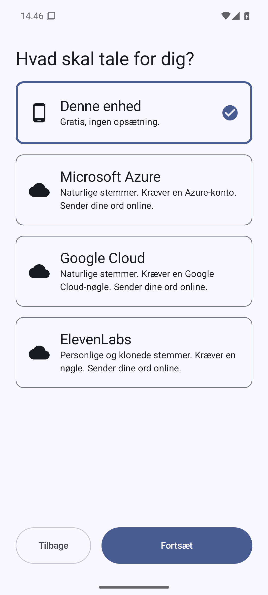

<!-- SCREENSHOT: Android welcome step “Hvordan vil du kommunikere?” showing the two cards Skrivning and Skærme. -->
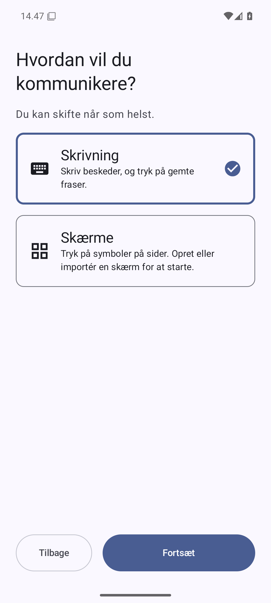

## De to arbejdsområder

Når opsætningen er færdig, åbner Wingmate det sted, du valgte. Du kan skifte, når du vil:

- Fra Skrivning: **Skift til skærme** (Android) eller **Skift til Skærme** (iPhone og iPad).
- Fra Skærme: **Skift til tastatur og fraser** (Android) eller **Skift til Skriv** (iPhone og iPad).

Under **Indstillinger** kan du vælge, hvad appen skal **Åbn ved opstart**: **Tastatur** eller **Skærme**. Vælger du Skærme, kan du også vælge en bestemt skærm, eller **Skærmoversigt** / **Skærmbibliotek**.

<!-- SCREENSHOT: Typing workspace in communication use: message bar with some text, phrase grid or Typing Screen visible, and the control to switch to Screens visible in the toolbar or menu. Android preferred if labels differ. -->
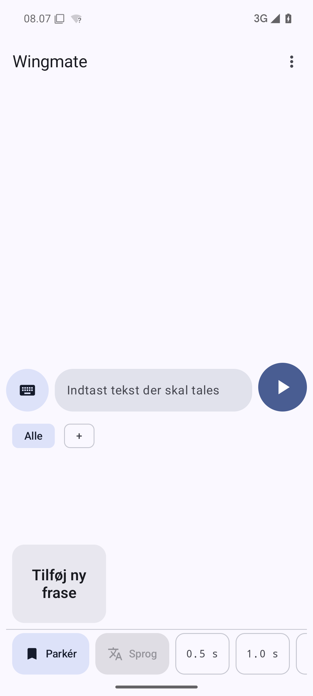

<!-- SCREENSHOT: Screens library (Skærme) with the title “Skærme”, at least one screen card, and actions such as Ny skærm / Opret skærm and Importer skærm / Importér tale visible. -->
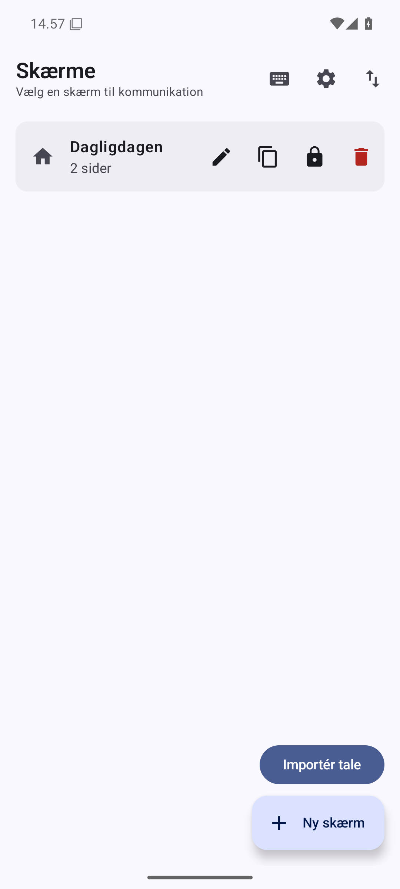

## Skrivning

I Skrivning skriver du en besked. Du kan også trykke på fraser, du har gemt.

- Skriv i feltet **Indtast tekst der skal tales** (Android). Tryk på afspil, så bliver beskeden læst op. Mens den læser, kan du bruge **Pause**, **Fortsæt** og **Stop**.
- Skift mellem **Vis tastatur** og **Vis skriveskærm**. Skriveskærmen viser fraserne som knapper. Den faste opstilling kan du ikke ændre, nulstille eller slette.
- Du starter som regel på siden **Alle**. Hver kategori får sin egen side. Er talehistorik tændt, kan siden **Historik** vises. **Sandsynligt næste** er en side, der foreslår hele beskeder ud fra det, der er sagt på denne enhed. Den er stadig ny. Du tænder den under **Indstillinger → Privatliv**.
- Gem en frase med **+** eller feltet **Tilføj** på iPhone og iPad. Arket hedder **Ny frase**. På Android trykker du på **Tilføj ny frase** på skriveskærmen.
- På Android kan du sætte **Vokalisering (det der skal siges)**, billede (**Foto** eller **Symbol**), **Farve**, en personlig **Optagelse** og hvilken kategori frasen hører til. Du kan markere den som **Skjult**, så den ikke vises blandt knapperne.
- På iPhone og iPad hedder felterne **Titel** og **Udtale**. Det, du skriver under **Udtale**, er teksten på frasen. Det, du skriver under **Titel**, er det, der bliver sagt, hvis du udfylder feltet. Billede vælger du under **Symbol** som **OpenSymbols** eller **Mine fotos**. Du kan også lave en **Optagelse**. Farve, kategori og **Skjult** findes ikke i dette ark.
- Hold fingeren på en frase for at rette den, eller træk den for at flytte den. På iPhone og iPad kan du også flytte den med **Flyt tidligere** og **Flyt senere**, hvis de knapper vises.
- Læg fraser i kategorier med **Tilføj kategori**. En kategori kan ikke ligge inde i en anden kategori.
- Du kan lægge den aktuelle besked til side og starte på en ny. Den gemte tekst vises som **Parkeret:**. **Byt** bytter om på den besked, du skriver på, og den, der ligger til side.

<!-- SCREENSHOT: Phrase editor dialog/sheet open (Tilføj ny frase or Rediger frase on Android; Ny frase on iOS) showing fields for text, vocalization, image (Foto / Symbol), color, and category. -->

## Skærme

En **skærm** er et sæt sider med et navn. Der er knapper på siderne, og én side er startsiden. Oversigten hedder **Skærme** («Vælg en skærm til kommunikation»).

### Opret eller importér en skærm

Sådan laver du en ny skærm:

1. Tryk **Ny skærm** eller **Opret skærm**.
2. Giv den et **Skærmnavn**.
3. Vælg en skabelon:
   - Android: **Tom**, **Lommeregner** eller **Tastatur** (layout **QWERTY** eller **Alfabetisk**). Til en tom skærm vælger du antal **Rækker** og **Kolonner**.
   - iPhone og iPad: under **Tavletype** vælger du **Tom tavle**, **QWERTY-tastatur** eller **Alfabetisk tastatur**. Lommeregner findes ikke på iPhone og iPad. Til en tom tavle vælger du **Rækker** og **Kolonner** (1–12).

Du kan også hente en skærm ind udefra:

- **Importer skærm** åbner en tavlefil. Filen ender på `.obf` (én side) eller `.obz` (flere sider og billeder). Filer med adgangskode kan ikke hentes ind. Gem dem først uden adgangskode.
- **Importér tale** laver en skærm ud fra tekst, du sætter ind. Du kan rette skærmen bagefter.
  1. Sæt teksten ind.
  2. En tom linje starter en ny knap. En linje, der starter med #, bliver sidens navn og bliver ikke læst op.
  3. I forhåndsvisningen kan du samle eller dele afsnit. Vælg, hvor mange afsnit der skal være på hver side (1–8).
  4. Tryk **Opret skærm**.

Når du senere trykker på en knap fra **Importér tale**, læser Wingmate hele afsnittet op med det samme. Teksten lægges ikke i beskedlinjen.

Fra oversigten kan du **Åbn**, **Rediger**, **Dupliker**, **Lås** / **Lås op** (på iPhone og iPad: **Lås skærm** / **Lås skærm op**) og slette en skærm. En slettet skærm kan ikke fortrydes.

<!-- SCREENSHOT: New screen dialog on Android, showing template choices Tom, Lommeregner and Tastatur, plus name and grid size fields for a blank screen. -->
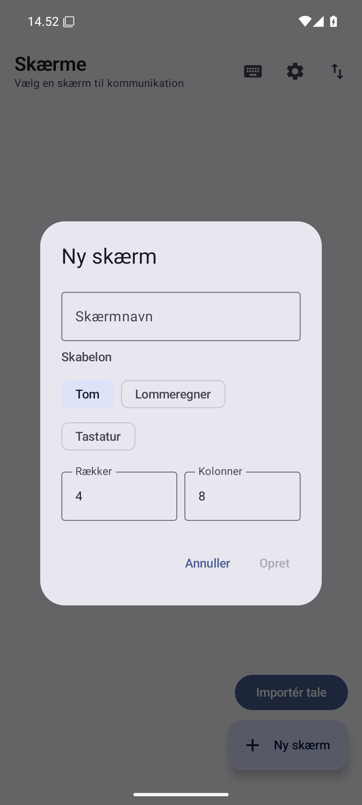

<!-- SCREENSHOT: Importér tale sheet with sample pasted text, paragraph-per-page control, and a preview of generated pages. -->
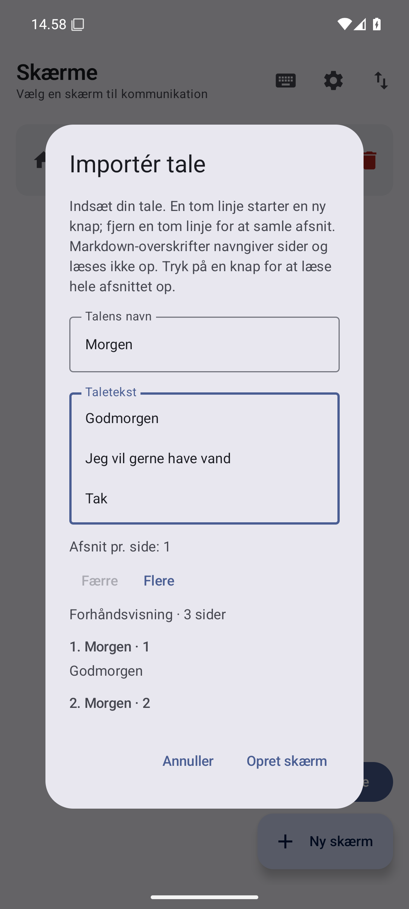

### Kommunikér med en skærm

Åbn en skærm, og tryk på knapperne. En knap kan læse op, lægge tekst i beskedlinjen eller åbne en anden side. Det afhænger af, hvordan knappen er sat op.

Er **Beskedlinje** vist, kan du læse beskeden op, slette det sidste og rydde det hele.

- Android: knapperne hedder **Afspil**, **Slet ord** og **Ryd**, når der er plads til tekst. På en smal skærm er de ikoner. Læser telefonen knapperne højt, hører du **Læs sætningen op**, **Slet sidste ord** og **Ryd sætningen**.
- iPhone og iPad: knapperne hedder **Afspil** (og **Stop**, mens der læses op), **Slet sidste** og **Slet alt**. Du kan også **Parkér beskeden**.

**Forrige side** og **Startside** går tilbage eller til start. Er **Stryg mellem sider** tændt under tilgængelighed, kan du også stryge til siden ved siden af. Første og sidste side hopper ikke rundt.

På iPhone og iPad virker strygningen ikke, mens **Vælg ved berøring** eller **Hold for at vælge** er tændt. På Android virker strygningen stadig. Hjælpeteksten på Android nævner kun **Vælg ved berøring**.

<!-- SCREENSHOT: An open Screen in communication (not editing) mode: a grid of symbol buttons, message bar at the top or bottom with a short composed message, and page navigation (Forrige side / Startside) visible. Prefer a simple child-friendly board if one can be created quickly, otherwise a blank grid with a few labeled buttons. -->
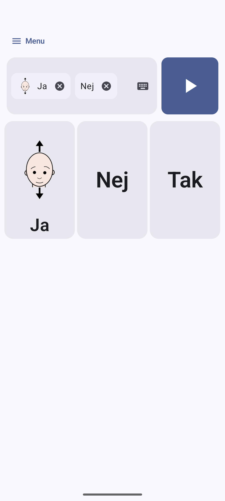

### Rediger sider og knapper

Tryk **Rediger** eller **Rediger skærm**. Er skærmen låst, skal du låse den op først («Lås skærmen op før redigering»). Er der sat en redigeringskode, skal den tastes først. Se [Låsning af redigering](#låsning-af-redigering).

Mens du redigerer:

- Hold fingeren på en knap, og vælg **Rediger**, **Tilpas størrelse** eller **Fjern**. Du kan også trække knappen til et andet felt.
- På iPhone og iPad kan du flytte og ændre størrelse felt for felt med **Flyt op/ned/venstre/højre** og **Bredere**, **Smalere**, **Højere**, **Lavere**. En knap kan dække flere felter, hvis de er ledige.
- **Tilføj side** laver en ny side. **Brug som startside** gør den aktuelle side til start. **Tilpas sidens størrelse** ændrer antal rækker og kolonner. Felter, der ikke kan være der, skal flyttes (Android) eller fjernes (advarsel på iPhone og iPad), før siden kan gøres mindre.
- **Vis skjulte knapper midlertidigt** viser knapper, der er skjult, mens du redigerer.
- **Afslut redigering** spørger, om ændringerne skal gemmes. Du kan **Gem ændringer**, **Kassér** eller **Fortsæt redigering**. **Fortryd** tager det sidste trin tilbage, mens du stadig redigerer.

<!-- SCREENSHOT: A Screen in edit mode (banner or title “Redigerer: …”). One button is selected or a context menu shows Rediger, Tilpas størrelse and Fjern. Empty cells and the finish-editing action are visible. -->
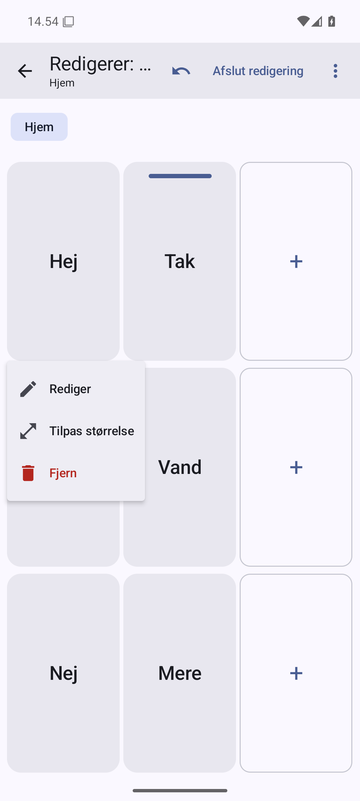

### Symboler, billeder, farver og størrelse

Når du redigerer et felt, kan du blandt andet sætte:

- **Etiket** – teksten, der står på knappen.
- **Udtale (valgfri)** på Android og **Vokalisering** på iPhone og iPad – det, der skal siges, hvis det skal være noget andet end etiketten.
- Et billede. Søg efter et symbol, eller vælg et foto fra enheden. Søgeskærmen hedder **Søg efter symboler** (feltet **Søg efter piktogram...**). Søgningen henter symboler fra OpenSymbols. Det er en samling af billeder, blandt andet fra ARASAAC og Mulberry. På Android kan du under **System og data** hente hele ARASAAC-biblioteket ned, så det virker uden net. Det fylder omkring 300 MB. Brug gerne wi-fi.
- **Feltfarve**, **Knapform** (**Rundet**, **Firkantet**, **Pille**, **Taleboble**, **Tankeboble**) og **Ordtype**. Ordtype kan være automatisk, eller du vælger selv: stedord, udsagnsord, beskrivende ord, navneord, socialt ord, andet.
- **Skjult i brugstilstand** – knappen er der stadig, når du redigerer, men vises ikke, når I taler.
- **Sprog** for den enkelte knap, hvis den skal siges på et andet sprog end det normale.

**Ordtypefarver** er Fitzgerald-farver. Hver ordtype får sin egen farve, så det er lettere at se, hvad ordet er. De er slukket fra start. Tænd dem under **Indstillinger → Skærm og layout** på Android, hvor de hedder **Ordtypefarver**. På iPhone og iPad hedder de **Automatiske Fitzgerald-ordtypefarver** under **Indstillinger → Visning og layout**. Sætter du selv en farve på knappen, er det den farve, der bruges.

<!-- SCREENSHOT: Edit-cell dialog/sheet (Rediger felt) with label, vocalization, an image or symbol on the button, color control, and shape or word-type options visible. -->
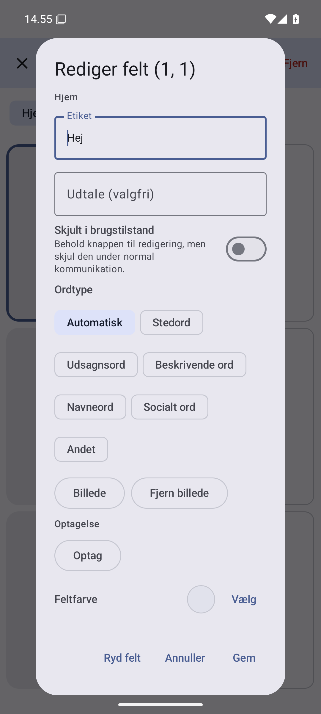

<!-- SCREENSHOT: Symbol search screen “Søg efter symboler” with a search query entered and a grid of matching pictograms from OpenSymbols. -->

### Sider og navigation

Under **Felthandling** / **Hvad knappen gør** vælger du, om knappen skal **Tilføj og udtal** eller **Åbn side**. Ved **Åbn side** vælger du en **Målside**.

**Særlige handlinger** kan lægges på en knap. På Android hedder de blandt andet:

- **Stav et ord**
- **Tilføj mellemrum**
- **Slet sidste tegn**
- **Ryd sætning**
- **Gå til startside**
- **Udtal sætning**
- **Forudsig næste ord**

Har du tændt flere handlinger, kan du ændre rækkefølgen med **Flyt handling op** og **Flyt handling ned**.

Når en almindelig knap er valgt, kan appen **Bliv på denne side**, **Gå tilbage til forrige side** eller **Gå til startsiden**. Du sætter det som standard i indstillingerne. Du kan vælge noget andet for en enkelt skærm eller side.

### Skærm- og sideindstillinger

Åbn **Skærmindstillinger** eller **Sideindstillinger**. Her kan du blandt andet:

- give skærmen eller siden et nyt navn
- **Vis etiketter** og **Vis symboler**, og vælge **Etikettens placering** (**Øverst** eller **Nederst**), når begge vises
- tænde eller slukke **Beskedlinje**, **Oplæsningsknap i beskedlinjen** og **Redigerbar beskedlinje**
- sætte **Aktivering af knap**: **Læs op og tilføj**, **Tilføj uden oplæsning** eller **Læs op uden at tilføje**
- sætte **Efter valg** (bliv, forrige side eller startside)
- vælge **Sidebaggrund** og et **Baggrundsbillede** (**Fyld siden** / **Hele billedet**, på iPhone og iPad **Udfyld** / **Tilpas**)
- tænde **Forudindlæs tale**. Så laver Wingmate lyden til alle knapper på forhånd med den stemme, du har valgt på nettet. Det koster hos den, der leverer stemmen, og det fylder på enheden. Det er slukket fra start.

En side kan **Brug skærmindstilling** eller **Brug appstandard**. **Nulstil skærmindstillinger** og **Nulstil sidetilpasninger** fjerner dine egne valg.

<!-- SCREENSHOT: Screen settings page (Skærmindstillinger) showing appearance and communication options such as Vis etiketter, Vis symboler, Beskedlinje and Aktivering af knap. -->
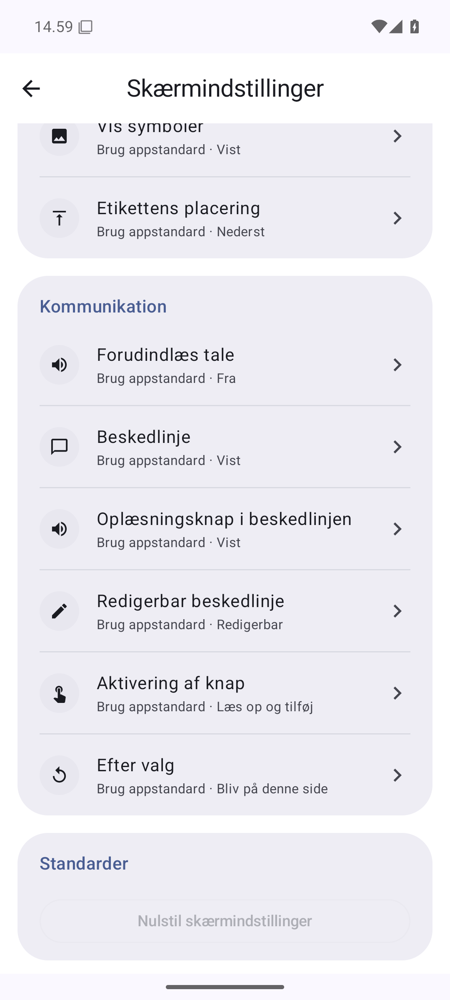

## Låsning af redigering

Der er to låse. Begge stopper kun redigering. Du kan altid tale.

**Redigeringsadgang** er en valgfri kode til hele appen. Du finder den under **Indstillinger → System og data** på Android og **Indstillinger → Generelt** på iPhone og iPad.

- Tryk **Kræv en redigeringskode** / **Kræv redigeringskode**.
- Koden er 4 til 8 cifre. På Android står der: «Indtast 4 til 8 cifre. Koden blokerer aldrig kommunikation.»
- Bagefter kan du **Skift redigeringskode**, **Deaktivér redigeringskode** og (på Android) **Lås redigering nu**.
- Efter flere forkerte forsøg venter appen, før du kan prøve igen («For mange forsøg. Vent et øjeblik, og prøv igen»).
- Wingmate bruger kun denne kode med tal. Den bruger ikke Face ID, Touch ID eller enhedens egen kode.
- Koden kommer ikke med i en sikkerhedskopi. Efter en gendannelse skal du sætte koden igen, hvis du vil bruge den.

**Lås** på den enkelte skærm fryser sider og knapper. De kan ikke ændres, før skærmen låses op. Er redigeringskoden tændt, skal den tastes for at låse eller låse op. En låst skærm vises som **Låst** i oversigten. Du kan stadig åbne den og tale.

<!-- SCREENSHOT: Settings section Redigeringsadgang, with the description “Kræv eventuelt en kode til redigering. Kommunikation er altid tilgængelig.” and the action Kræv en redigeringskode (or the enabled state with Skift / Deaktivér). -->

<!-- SCREENSHOT: Screens library showing a screen marked Låst, with the unlock action (Lås op / Lås skærm op) visible and the Edit action disabled or unavailable. -->
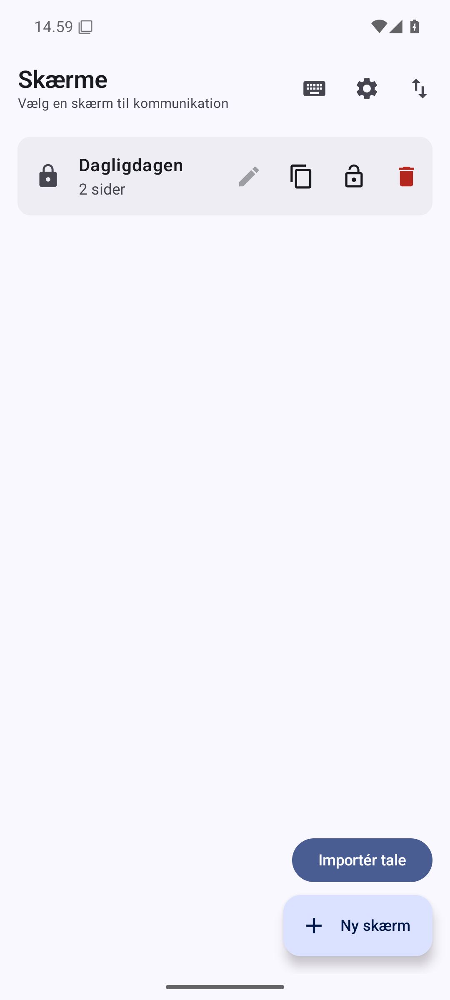

Lås og oplåsning kan virke lidt forskelligt på Android og på iPhone eller iPad.

## Stemmer

Du vælger, hvad der skal tale, i opsætningen eller under **Indstillinger → Tale og sprog**.

| Det hedder i appen | Hvad du får | Skal du være på nettet? |
| --- | --- | --- |
| **Denne enhed** i opsætningen. I indstillingerne **System** og **System-TTS** | Enhedens egne stemmer. På iPhone og iPad er det de indbyggede stemmer, også en personlig stemme, du selv har lavet på enheden. | Kan virke uden net. Nogle stemmer på enheden bruger alligevel internet. |
| **Microsoft Azure** i opsætningen. I indstillingerne **Azure** og **Azure TTS** | Naturlige stemmer fra Microsoft. Du bruger din egen nøgle. | Kræver internet. Dine ord sendes til Microsoft. Det kan koste penge. |
| **Google Cloud** i opsætningen. I indstillingerne **Google** og **Google Cloud TTS** | Stemmer fra Google. Du bruger din egen nøgle. | Kræver internet. Dine ord sendes til Google. Det kan koste penge. |
| **ElevenLabs** | Stemmer fra din ElevenLabs-konto, også en kopi af en stemme, du selv har lavet der. | Kræver internet. Dine ord sendes til ElevenLabs. Det tæller med i din konto. |

En stemme på enheden kræver ingen nøgle. Stemmerne på nettet kræver en nøgle, du selv laver hos Microsoft, Google eller ElevenLabs. Wingmate gemmer nøglen sikkert på enheden. Den kommer ikke med i en sikkerhedskopi.

Sådan sætter du en stemme på nettet op:

1. Vælg Microsoft, Google eller ElevenLabs.
2. Sæt nøglen ind.
3. Gem den. På Android hedder knappen **Gem**. På iPhone og iPad hedder den **Gem sikkert og bekræft** for Google Cloud og ElevenLabs. Er telefonen ikke sat til dansk, kan den engelske tekst *Save securely and verify* stå i stedet. Azure på iPhone og iPad bruger **Gem og fortsæt**.

Virker nøglen ikke, beholder Wingmate den gamle opsætning.

Derefter vælger du en stemme i **Vælg stemme**, et **Hovedsprog** og eventuelt et **Andet sprog**. Du kan også sætte hastighed og tonehøjde, hvor stemmen kan det.

ElevenLabs kan ikke ændre tonehøjde her. Hastigheden kan også blive ignoreret. Skriv i stedet en lille bemærkning i firkantede klammer i teksten, for eksempel `[slowly]`, når ElevenLabs er valgt.

Er stemmen på nettet ikke til at få fat i, læser enhedens stemme op i stedet. Wingmate siger, at stemmen i skyen ikke var tilgængelig. Beskeden bliver ikke slettet.

Under **Udtaleordbog** kan du lære Wingmate, hvordan navne og ord skal siges. Ordbogen bruges, når appen laver tale. Den bruges ikke på de dele, ElevenLabs læser.

Vil du vide mere om nøgler og stemmer, så se [elevenlabs-tts.md](elevenlabs-tts.md) og [google-cloud-tts.md](google-cloud-tts.md).

<!-- SCREENSHOT: Settings → Tale og sprog, with the speech engine options (System, Azure, Google, ElevenLabs) and a selected voice visible. The selected engine can also be shown as System-TTS, Azure TTS or Google Cloud TTS. -->
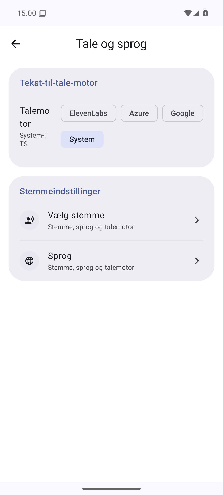

<!-- SCREENSHOT: Voice picker (Vælg stemme) filtered to a language, with at least one voice selected and the preview/play control visible. -->
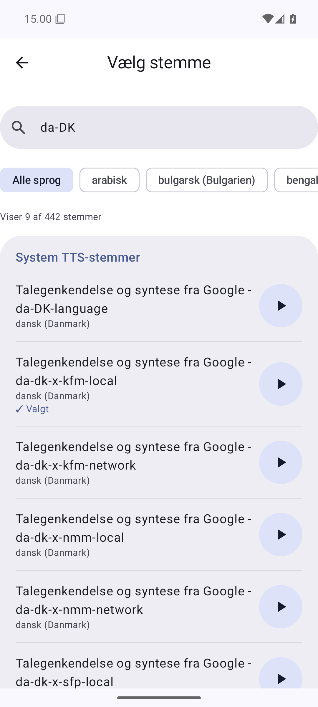

## Import og eksport

Ord til skærme flyttes som en fil. Der er ingen konto, de følger med.

**Hent ind** fra oversigten **Skærme**:

- En tavlefil: `.obf` er én side. `.obz` er flere sider og billeder.
- **Importér tale**, som beskrevet ovenfor.

**Send ud** fra en åben skærm. Tryk **Eksportér**:

- **Open Board (.obz)** – skærmen i en fil, som andre ASK-apps også kan læse.
- **Eksportér til Grid** – en fil til Smartbox Grid 3. I Grid Explorer vælger du **Add Grid Set → Grid set file**. [Smartbox’ vejledning til Grid Explorer](https://hub.smartboxaac.com/knowledgebase/grid-explorer-in-grid-3/).
- Udskrivning: på Android **Udskriv (PDF)**. Knappen ligger i samme menu som **Importer/eksporter data**. På iPhone og iPad hedder den **Eksportér skærm som PDF**. Du får som regel ét liggende A4-ark pr. side. En knap, der går til en anden side, får skrevet, hvilken side den går til.

Til Grid følger siderne med, knappernes plads og størrelse, tekster, det der skal siges, farver og de billeder og lyde, Grid kan afspille. Er beskedlinjen tændt, lægger Wingmate en talerække øverst i Grid. Optagelser, som Grid kan afspille, afspilles, når knappen vælges. En samlet besked sendes som tekst.

Det her følger ikke med til Grid: ordforslag i Wingmate, ekstra elementer på siden, baggrundsbilleder og et særligt stemmevalg på den enkelte knap. Wingmate kan sende en skærm til Grid. Den kan ikke hente en Grid-fil ind igen.

Skriveskærmens faste opstilling følger ikke med, når du sender siderne ud.

<!-- SCREENSHOT: The Screen export menu open, showing Open Board (.obz), Eksportér til Grid, and the PDF print/export action. -->
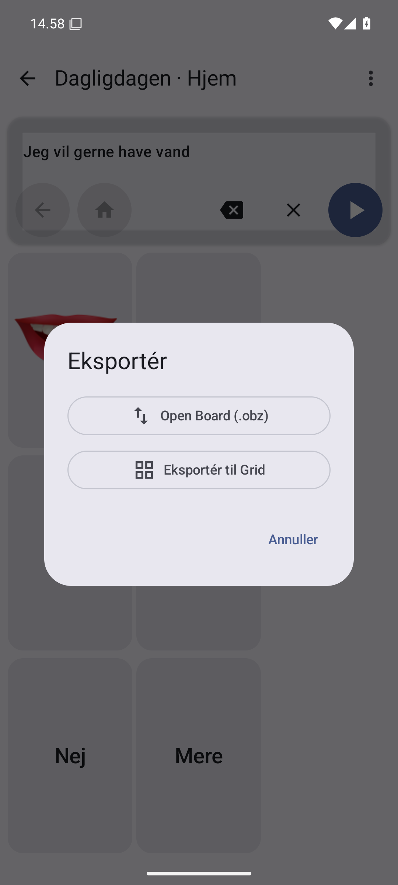

## Sikkerhedskopi

En sikkerhedskopi er et billede af Wingmate på *denne* enhed. Den er ikke en måde at dele tavler med andre.

Du finder **Sikkerhedskopiér Wingmate** under **Indstillinger → System og data** på Android og **Indstillinger → Privatliv** på iPhone og iPad.

- **Opret sikkerhedskopi** gemmer eller deler en fil. Den ender på `.wingmate-backup`.
- **Gendan sikkerhedskopi** tjekker filen. Bekræfter du **Validér og erstat**, erstatter den det, der ligger på enheden nu. Trykker du nej, sker der ingenting.

Kopien kan indeholde skærme, sider, fraser, kategorier, billeder, optagelser, indstillinger, talehistorik, stemmevalg og udtaleordbog. Teksten på skærmen nævner også Azure. Nøglen til stemmen på nettet følger ikke med. Det gør redigeringskoden og midlertidige lydfiler heller ikke. Efter en gendannelse skal du sætte nøglen og eventuel redigeringskode op igen.

Filen er ikke låst med en kode. Den kan indeholde dine beskeder. Gem den et sikkert sted.

Vil du se, hvordan filen er bygget op, så læs [BACKUP_FORMAT.md](BACKUP_FORMAT.md).

<!-- SCREENSHOT: The Sikkerhedskopiér Wingmate settings group, showing the description and the buttons Opret sikkerhedskopi and Gendan sikkerhedskopi. -->
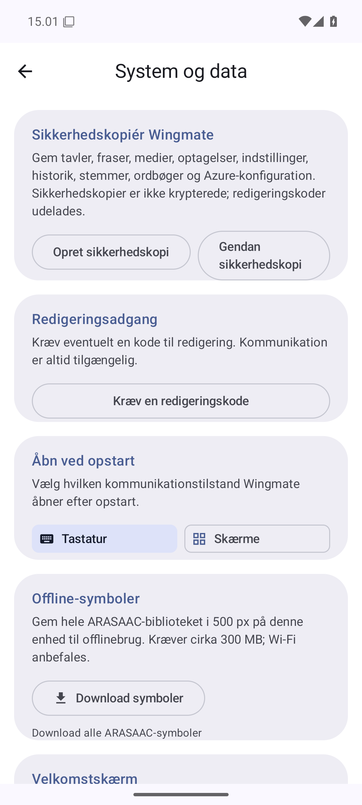

## Indstillinger

Åbn **Indstillinger**. Fra skrivning på Android hedder knappen også **App-indstillinger**. På Android kan du søge med **Søg i Indstillinger**. **Udtaleordbog** ligger også som sit eget punkt på forsiden.

| Afsnit (Android) | Afsnit (iPhone og iPad) | Her finder du blandt andet |
| --- | --- | --- |
| **Tale og sprog** | **Tale og sprog** | Hvad der taler, stemme, sprog, hastighed, udtaleordbog |
| **Skærm og layout** | **Visning og layout** | Etiketter og symboler, knappernes opstilling, kontrast, **Ordtypefarver**, skrift- og knapstørrelse, beskedlinje |
| **Tilgængelighed** | **Tilgængelighed** | Berøring og tid, betjening, lyd og markering. På iPhone og iPad også **Scanning** |
| **Privatliv** | **Privatliv** | **Vis talehistorik**, **Sandsynlige næste beskeder (eksperimentel)**, gemte sætninger, anonym rapportering. På iPhone og iPad også sikkerhedskopi |
| **System og data** | **Generelt** | **Åbn ved opstart**, redigeringskode. På Android også sikkerhedskopi og hentning af ARASAAC-symboler |

Andre valg, der er gode at kende:

- **Tale ved valg**: **Straks** eller **Kun sætning**. Ved **Kun sætning** er appen stille, indtil den samlede besked læses op.
- **Vis talehistorik**: kun tale, der afspilles, mens dette er tændt, vises i historikken. Tale, der er skjult, kan stadig ligge på enheden, så lyden kan bruges igen.
- **Rapportering af funktionsbrug**: valgfri, og slukket fra start. Ingen frasetekst, nøgler eller filstier sendes. Se [PRIVACY_POLICY.md](../PRIVACY_POLICY.md).
- **Standardiseret logning (OBL)**: en lokal liste over brugen, som en terapeut kan gennemgå. Listen bliver på enheden.
- På iPhone og iPad: **Partnerskærm** kan vise beskeden med stor tekst på en tilsluttet skærm, der vender ud mod den, du taler med. Valgene er **Fra**, **Kun ved oplæsning** og **Under skrivning og oplæsning**. Den skjules under den første opsætning, under indstillinger, når redigeringskoden tastes, og mens du redigerer.

Fra skrivning kan du som regel også åbne **Stemmeindstillinger**, **Velkomstskærm** og **Importer/eksporter data**.

<!-- SCREENSHOT: The Settings home/overview, showing the category list: Tale og sprog, Skærm og layout (or Visning og layout), Tilgængelighed, Privatliv, and System og data (or Generelt). -->
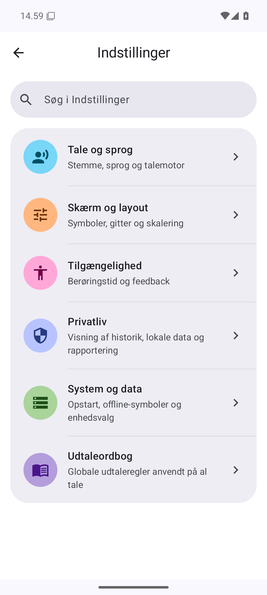

## Tilgængelighed og betjening

Under **Tilgængelighed** kan du ændre, hvordan der peges og vælges. **Valgtast** og hviletilstand ligger i gruppen **Interaktion** på Android og under **Betjening** på iPhone og iPad.

- **Hold for at vælge (ms)** – knappen vælges først, når du har holdt fingeren nede. `0` slår det fra.
- **Dwell-valg (ms)** / **Dvæl for at vælge** – knappen vælges, når markøren bliver stående på den, uden at du klikker. `0` slår det fra.
- **Vælg ved berøring** – knappen vælges, så snart du rører den, ikke når du slipper. Knapfelterne ruller ikke længere. **Hold for at vælge** gælder stadig, hvis det er tændt. På iPhone og iPad slår det også sidestrygning fra. På Android bliver sidestrygning ikke slået fra.
- **Stryg mellem sider** – stryg til siden ved siden af.
- **Markeringsde-bounce (ms)** – ignorerer hurtige tryk på den samme knap lige efter hinanden.
- **Markeringsfremhævning (ms)** og **Markeringslyd** – en kort ramme og en lyd, når en knap er valgt.
- **Auditiv bekræftelse** (Android) / **Auditiv søgning** (iPhone og iPad) – hvisker teksten, når en knap berøres eller holdes over.
- **Valgtast** – mellemrum, Enter eller en funktionstast, du selv vælger, bruger det, markøren eller tastaturet står på. Hold tasten nede i 2 sekunder i hviletilstand for at komme i gang igen.
- **Tast til hviletilstand** – sætter dwell og valgtast på pause. Knappen sidder i bunden af skærmen: **Hviletilstand** / **Genoptag input**. Almindelige tryk virker stadig, mens der hviles.
- **Fremhævelse af markør** på Android og **Markørfremhævning** på iPhone og iPad – behold den almindelige markør, eller læg en tydelig ring eller et omrids ovenpå. På Android hedder valgene **System**, **Ring** og **Outline**. På iPhone og iPad hedder de **System**, **Ring** og **Omrids**.

Wingmate kan bruges med finger, mus, pegefelt, tastatur, kontakt og den markør, systemet stiller til rådighed. Det gælder også øjen- og hovedstyring, når systemet giver en markør. På iPhone og iPad kan du bruge Øjenstyring (iOS/iPadOS 18 eller nyere), Hovedstyring, Kontaktstyring (Switch Control) og Stemmestyring. Se [HEAD_EYE_TRACKING.md](HEAD_EYE_TRACKING.md).

**Scanning** findes på iPhone og iPad under **Tilgængelighed → Scanning**. Der kan du sætte områder, rækkefølge, dvæl og automatisk videre. Den samme scanning findes ikke på Android i denne version.

<!-- SCREENSHOT: Settings → Tilgængelighed, showing Hold for at vælge, Dwell/Dvæl, Vælg ved berøring and Stryg mellem sider. On iOS, include the Scanning section if it fits without cropping the other controls; otherwise capture Scanning separately and keep this frame on the touch-timing controls. -->
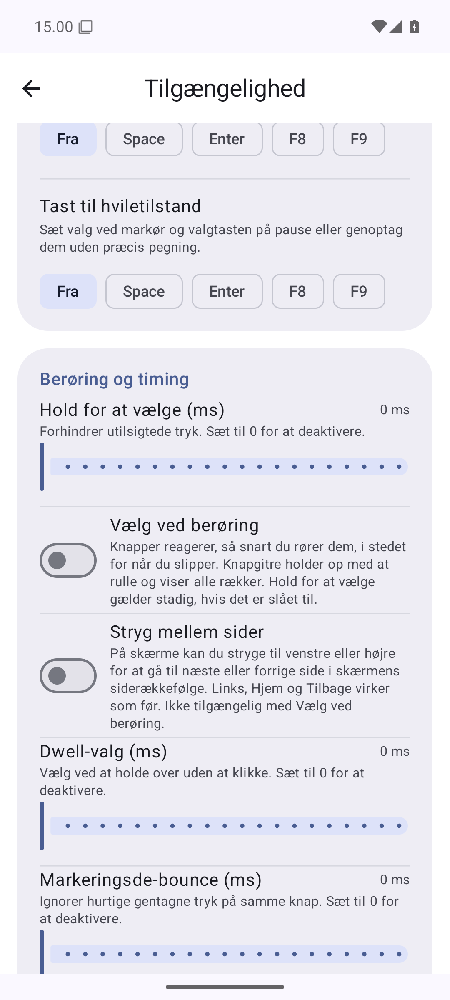

## Fejlfinding

**Stemmen på nettet virker ikke.** Tjek, at du har internet, og at nøglen stadig virker. Wingmate bruger enhedens stemme i stedet og beholder beskeden. I opsætningen eller på stemmelisten kan du trykke **Indtast nøglen igen**, hvis nøglen er blevet ændret.

**Stemmerne på enheden mangler eller lyder forkert.** På iPhone og iPad hentes og vælges stemmer som regel under **Tilgængelighed → Talt indhold → Stemmer** i indstillingerne til iOS. På Android styres de af enhedens egne indstillinger for oplæsning.

**En tavlefil kan ikke hentes ind.** Appen siger selv, hvad der er galt. Filen kan ikke åbnes, er ikke en tavle Wingmate kan læse, er gået i stykker, er for stor, mangler billeder eller lyde, eller er låst med en adgangskode.

**Skærmen kan ikke redigeres.** Se, om skærmen er **Låst**, og om redigeringskoden er tændt. Lås op, og tast koden, hvis der bliver spurgt om den.

**Jeg har glemt redigeringskoden.** Koden ligger kun på enheden og kommer ikke med i en sikkerhedskopi. Wingmate kan ikke nulstille den for dig. Gem koden et sikkert sted. Sidder du fast, så skriv til udvikleren.

**Historik eller «Sandsynligt næste» vises ikke.** Tænd **Vis talehistorik**. **Sandsynlige næste beskeder (eksperimentel)** vises kun, mens historik er synlig. Rækken over tastaturet vises kun, mens tastaturet er fremme.

**Søgningen finder ingen symboler, eller den er langsom.** Søgningen kræver net, medmindre symbolerne allerede ligger på enheden. Har du søgt for mange gange, beder appen dig vente og prøve igen. På Android kan du hente ARASAAC ned, så det virker uden net.

**Appen er på et andet sprog end forventet.** Sproget følger enhedens sprog, når oversættelsen findes. Dansk findes både på Android og på iPhone og iPad.

**Computerudgaven.** Denne version er til Android og iPhone/iPad. Udgaven til computer er lagt på pause.

## Giv feedback

Fejl, ønsker og spørgsmål kan sendes som en sag på GitHub: [github.com/Jdreioe/Wingmate/issues](https://github.com/Jdreioe/Wingmate/issues).

På Google Play er supportadressen [wingmate@dreioe.dk](mailto:wingmate@dreioe.dk).

Når du beskriver et problem, så skriv gerne hvilken enhed og hvilken version af appen du bruger, og om det sker i **Skrivning** eller **Skærme**.
